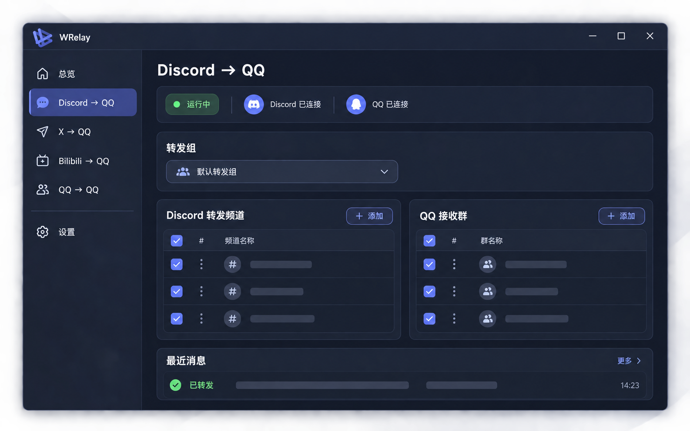

# WRelay 设计概念图

总览页停止机器人按钮左侧提供同尺寸的文件图标按钮，点击后选择「导出配置」或「上传配置」；其他页面不显示该入口。桌面端优先使用原生保存窗口并显示保存路径，原生接口未就绪时回退到浏览器下载。账号切换重新加载该账号的来源与转发组，并立即刷新运行状态、RSS 状态、补发数量和最近消息；总览接收群数量按当前账号归属计算。来源、转发组、授权用户、手动转发筛选、定时计划和翻译路由按账号独立存储；新投递记录及 Discord 统计按账号显示，无法归属的旧记录不计入账号数据。翻译服务凭据仍为共享配置。
点击「上传配置」后直接打开文件选择器；选中文件后才显示简短的来源、群和授权用户摘要，并在「确认导入」后写入配置。桌面端优先使用原生文件选择器，原生接口未就绪时回退到 WebView 文件选择器；网页端使用浏览器选择器。
导出和上传菜单项直接绑定各自的点击操作；导出打开保存对话框，上传打开文件选择器。上传确认窗口的底栏使用独立容器，供公共弹窗组件迁移确认按钮，确保窗口其余控件保留在页面中。
弹窗使用标题栏 × / Esc / 遮罩关闭。全局凭据、账号授权、定时计划和翻译设置不随账号配置导出，详见 [Bot 独立配置](BOT_PROFILES.md)。

设置页的连接诊断、消息追踪、确认窗口与配置向导同样支持上述关闭方式；向导关闭时继续保存进度，配置窗口的保存和取消入口保持原有行为。

设置页新增「个人 QQ」二级窗口，沿用公共 Modal（中等宽度、正文滚动、右下保存、标题栏 × / Esc / 遮罩关闭）。
每个连接使用两列字段、整行状态和胶囊启停开关，支持接收群选择及待确认投递处理。
个人号与官方机器人共用工作区选择器，名称显示 QQ 号及启用状态；个人目标可进入 QQ → QQ 转发组及定时消息选择。
个人用户私聊 `/注册` 后以 `personal:<QQ号>` 进入现有白名单，默认关闭，管理员明确启用后才能管理和手动转发。
连接、令牌与未知结果的行为见 [PERSONAL_QQ.md](PERSONAL_QQ.md)。

本页保存 WRelay 项目概念图和桌面窗口布局参考。桌面程序采用 WebView2 窗口、左侧导航和托盘入口；图片中的占位条仅表达视觉结构，实际数据由桌面进程内的管理逻辑提供。

## 项目概念图

## 桌面端窗口布局

以下模板说明以当前代码为准；后文按日期记录的阶段方案保留为历史，以末尾“根滚动条稳定与全局日志归位”为最新规范。

### 共用功能页模板（以 Discord → QQ 为基础）

桌面端五个转发页统一采用“顶部机器人状态栏 → 转发组”的结构。Discord 离线补发由后台默认自动运行，管理面板不显示其状态卡片、详情窗口或手动操作按钮。X、Bilibili、YouTube RSS 与 Steam 状态可从顶部状态入口打开二级窗口；窗口复用对应状态卡片，关闭后恢复页面位置。QQ → QQ 页在最右侧按钮槽提供失败通知图标开关，其余操作槽保持预留。二级窗口高度随内容收紧，正文左右留出 20px 并与标题栏对齐；内容超过可用高度时只在正文内滚动。顶部机器人状态栏、转发组及其余功能卡片沿用现有统一布局规则。

QQ 定时消息卡片的标题从卡片内容区顶部起排，标题行保留相同的控件高度和帮助图标垂直居中；卡片其余内容继续使用各自布局。

转发组卡下方保留的功能卡片统一使用两列网格，间距 16px、1280px 及以下退化为单列，按从左至右、从上至下排列。QQ 定时消息、手动转发、自动翻译等卡片按网格规则排列；RSS 与 Steam 状态从顶部入口打开详情，不占用页面网格。

保留在页面网格中的功能卡片内部起排与按钮位置（长期有效）：卡片为 display:flex、纵向排列且间距为 0，标题在最上，可选的一句话说明紧随其后（顶部间距 8px），动作栏以自动上边距贴底并占满内容宽度；动作按钮从卡片左下角起排，成对图标动作才使用左右分布。胶囊开关默认贴左下角；详细说明写在标题旁帮助提示中，批量或次要设置通过入口打开二级窗口。

小卡片标题行统一为 36px 高、垂直居中，标题文字与问号在各卡片距顶位置一致；「自动翻译」卡的服务选择区与标题之间不绘制横向分隔线。

共享「自动翻译」卡同样只占网格中的一格，排在「手动转发」卡之后：卡内只有首选/次选服务两个下拉（窄格内自动换行）和左下角的「翻译链路」入口按钮。六条链路（Discord、X、Bilibili、YouTube、Steam、手动转发）的批量开关收进 `#translationChainsModal` 二级窗口（ModalShell `small`、无自定义页脚故自动生成「关闭」，与「已注册来源」同级），窗口内是一句话说明加六个上下排列的勾选式开关（圆角选项底、方框勾选在左、文字在右），点击仍走 `saveAndReload()` 保存并留在窗口内刷新状态；Discord、X、Bilibili、YouTube 和 Steam 的单个来源翻译选项统一在来源行「内容筛选」中设置，不再打开单独的来源翻译弹窗。Steam 来源提供是否翻译与是否保留原文两项；其他来源保留各自适用的时间设置。

转发组外层卡片在深浅主题下统一使用 `--card-bg` 与 `--panel-border`；来源和目标分栏使用独立的圆角表面，浅色主题以浅灰蓝底色和边框与外层卡片区分。表格中的名称、账号、来源值及 ID 在空间不足时以中间省略号保留开头和结尾。悬停或键盘聚焦任一值显示完整内容，右键复制完整值；键盘聚焦后按 Enter、空格或 Ctrl+C 也可复制，有选中文字时 Ctrl+C 保留原生复制。复制成功后提示固定在原位置显示 2 秒再淡出，使用 MingCute 勾选图标，值本身不变色。表格不再单独显示 ID 复制按钮。带外链的来源值左键打开原页面，右键复制链接文本。Steam 来源与接收群表格共享省略显示、复制和反馈规则。编辑输入保留原文。每个转发页的左右分栏折叠按钮成对同步，任意一侧展开或折叠时两侧内容、按钮状态和无障碍状态一致。

二级窗口统一规则（长期有效，适用于全部卡片二级窗口）：
正文中的文字按钮和勾选式开关按内容宽度显示，不因网格列被拉长；多个控件按内容排列，空间不足时换行。底栏的主要动作仍按下述规则贴右。
1. **内容网格式对齐**——`ui-components.js` 的 ModalShell 规格表用 `grid: true` 声明哪些窗口启用统一正文（当前为编辑定时消息、已注册频道、翻译链路、安全备份与恢复、运行日志、翻译设置、QQ/Discord 配置），`modalShell()` 据此给正文加 `.modal-grid`：单列起排、`justify-items: stretch`、行间距 14px，标题下每一行的左缘都与正文内边距对齐（基准是「已注册频道」的行式列表）。需要并排的容器加 `.modal-split`（等宽两列，内部 label 纵向起排），需要跨整行的元素加 `.modal-span-all`。旧窗口自带的内联底色/边框/内边距由 `body .modal-shell > .modal-body > div[style]` 统一失效，外观只由 `.modal-shell` 提供；「翻译服务配置」保留自己的两列正文。
2. **底栏左右分区**——`.modal-footer > button:first-child` 贴左下、`:last-child` 贴右下：主要动作（保存 / 确定 / 恢复配置 / 清空日志）一律右下角，取消、复制、上下文入口左下角；配置向导将「稍后配置／验证」「重新开始」并排放左侧，将「上一步」和主要动作并排放右侧。Discord Bot 与 QQ Bot 配置窗口左下角放的是平台外链（Discord 开发者门户 / QQ 机器人平台）而不是「取消」，关闭依赖标题栏 ×、Esc 与遮罩。正文内的按钮行用 `.modal-actions` + `.modal-actions-start` 复用同一分区规则（如「立即备份」左、「恢复所选备份」右）。只有一个按钮时（自动生成的「关闭」）保持贴右。
3. **开关按所在层级区分样式**——二级窗口中的开关使用勾选式选项（圆角选项底，方框勾选在左、说明文字在右），适用于翻译链路、自动备份及日志自动滚动；一级桌面端页面中的设置项开关使用胶囊轨道。转发组表格中的启用复选框和机器人状态卡片按钮不属于此规则。开关仍使用原有 `role="switch"`、`aria-checked` 与保存处理，不改变行为。一级页面的设置开关保持无外围按钮框，只保留 32×18 胶囊轨道；卡片开关按内容宽度排列，说明文字与轨道间隔 8px。
4. **编辑定时消息**沿用同一套规则：窗口正文单列，不显示「消息列表」标题或说明段、批量工具按钮；每条消息内容始终展开，正文与附件直接铺在窗口正文中，发送方式、周期和时间控件在同一行底端对齐；不设折叠按钮、附件说明段和分隔线；图片、视频或音频通过方形上传图标按钮添加，已有附件时显示方形垃圾桶按钮。接收群由消息组统一指定；「＋ 新增」打开只含一条空白消息的编辑器，保存后追加到当前组；消息行编辑只打开对应的一条消息，保存和删除按消息组与消息 ID 定位。

转发组沿用现有 Tab 与组级操作栏、固定布局表格、ID 截断/复制、危险图标按钮、拖动排序及空状态。配置向导位于设置页“应用”卡片末行；“外观与窗口”中“界面动画”排在“界面主题”上方；设置行右侧文字按钮与跳转链接共用页面字体、14px 字号和 20px 行高。两栏底部同一紧凑 footer 只放新增/注册等主操作，转发组页面不再挂平台外链；平台外链改挂到 Discord Bot / QQ Bot 配置二级窗口的底栏左侧。窄窗口继续沿用单栏断点。白名单新增/审核与转发群一致，直接在「QQ → QQ」页指定分栏底部操作栏完成，不再有独立的设置行与二级弹窗；手动转发与共享翻译卡遵循统一的小卡片标题规则，翻译卡内部不画分隔线。日志自动滚动使用 `.settings-switch-track`，提供 `role="switch"` 与实时 `aria-checked`，原保存流程不变。

五个功能页不显示全局日志。统一入口为“设置 → 启动与维护 → 运行日志”，使用标准 ModalShell：最高 320px 的深色等宽控制台内部滚动，正文下方排列级别、自动滚动和「消息追踪」，空间不足时换行；底栏两侧分别为「复制日志」和「清空日志」。日志级别说明不单独占行。连接诊断列表顶部不显示分隔线，刷新诊断位于底栏左侧，关闭按钮位于右侧。根 HTML 预留稳定滚动条空间，切页与折叠不改变可用宽度。

机器人状态卡与 X / Bilibili / YouTube RSS 状态卡在正常运行时显示渐变扫光；机器人状态卡的扫光使用与“运行中”徽标一致的主题绿色，RSS 状态卡沿用各自状态色。当前选中且启用的转发组标签也显示扫光，暂停的组不显示。设置 → 外观与窗口提供“界面动画”开关，默认开启；偏好保存在本机 localStorage，并立即作用于所有页面，开关所在行的扫光延伸到卡片左右内缘并扫过完整横向区域，边缘为直角，光带本身保持原宽度。转发组标签使用更宽、更淡的扫光，减弱中央亮斑的集中感。深色主题保持原有强度，浅色主题降低不透明度以减弱对比度；斜向光带每 8 秒从左向右循环。机器人动效要求进程运行、当前 QQ Bot 已连接；Discord 与总览还要求 Discord 已连接。连接任务仍在进行时视为等待状态，不显示失败光效；所需连接未建立且没有进行中的网关任务时，状态卡才切换为 4 秒循环的红色呼吸光。停止或连接检测中不显示该失败光效。非输入态连续输入 wrelayfail 可切换失败光效预览，再输入关闭。RSS 动效沿用现有绿色“运行中”判定；停止、等待连接和请求/解析失败时不显示。装饰层位于内容后方，不拦截点击，也不改变卡片尺寸和间距；关闭“界面动画”或系统启用“减少动态效果”时隐藏这些光效。

下拉框保留原生值和事件，控件文字与箭头垂直居中并分列两端；菜单使用圆角面板，选项文字与控件内边距对齐，悬停时提供清晰的品牌色反馈。当前值仍显示在控件上，但从展开列表中隐藏。桌面端保留的 HTML `title` 提示统一转为面板自制 `ui-tooltip` 样式，鼠标悬停或键盘聚焦时显示；不再使用浏览器/系统原生 title 浮窗，包括禁用控件和动态添加的提示。总览统计与链路状态、表格全选启用框、折叠按钮、转发组常用图标及指定设置开关属于无重复提示项，不显示 Tooltip。

`panel/web/discord-page.js` 保留原文件名，现为五个功能页共用的展示适配层：按页面配置选择工作区；移动现有控件而非复制控件，跨页切换先还原再安置。QQ 用户白名单表格（`#userList` / `#userBody`）与「＋ 新增」「注册审核」按钮直接写在 QQ → QQ 页转发组的第二个分栏中，沿用原元素 ID 与事件绑定，不再弹窗搬移。样式复用 Discord 的同一组规则，总览和设置页不采用紧凑功能页模板。表格行、复制、拖动、保存和配置弹窗仍沿用原处理函数。

Discord 转发频道表格将名称、来源和频道 ID 分列显示，顺序为「名称 → 来源 → 频道 ID」；Bilibili 转发组来源表分列显示「类型 → 名称 → 来源」，名称可在来源编辑中填写，来源显示来源值。来源行右侧统一提供「内容筛选」、编辑名称与来源地址、移除三个按钮，Discord 来源仍可点击打开对应频道。五条链路来源表的操作列统一预留 120px，以完整显示三个图标按钮；Steam 来源与 Steam 链接分列，链接可点击打开。各链路的来源与 QQ 群行内编辑按该行标识定位。移出成员按点击时的转发组和成员标识定位，列表刷新或重排后仍处理原条目。

QQ → QQ 页的授权用户行尾不再单独设置失败通知。QQ 状态栏最右侧按钮槽显示 MingCute 告警图标开关；开启后向名单中所有已启用用户发送失败与维护提醒。设置页的失败通知开关与状态栏图标共用同一全局配置。

X、Bilibili 和 YouTube 的 RSS 详情卡使用相同的状态区（桌面端由顶部图标入口打开二级窗口，普通网页端在对应页面显示）：标题独占首行，徽标与来源/轮询/投递统计同行，地址与间隔位于下一行。状态、来源、上次轮询、发现、发送、地址及间隔保留，Bilibili 另保留积压与保护设置。异常时保留统计信息，错误原因和普通统计分别着色。当前账号没有可轮询的 Bilibili 来源时，状态卡与上游状态入口用中性状态显示「无启用来源」。已有可轮询来源且首轮未完成时，上游入口才显示等待首次轮询。工作区采用与 Discord 相同的双栏、底部新增/注册结构；1280px 及以下转为单栏。Bilibili 来源注册选择来源范围和 UID、标签名或关键词地址；注册来源可在转发组行内编辑显示名称与来源地址。Discord、X、Bilibili、YouTube 和 Steam 的来源行右侧统一提供「内容筛选」、编辑名称与来源地址、移除三个按钮；X、Bilibili 和 YouTube 的备注、关键词、消息类型、推文/投稿类型及翻译选项均由「内容筛选」管理，并统一采用勾选框胶囊。Steam 的事件、DLC/捆绑包、新闻 feed 和翻译条件由同名内容筛选窗管理，基本编辑窗只编辑名称与地址。Bilibili 内容筛选沿用按关键词筛选及投稿类型选择的布局；UP 主来源支持视频、专栏、动态，标签与关键词来源仅支持视频。来源筛选不再提供额外标签、作者或标题条件。Bilibili 不再在自身页面放手动转发卡：手动转发统一收拢到「QQ → QQ」页的统一「手动转发」卡，右侧「已注册来源」弹窗与「内容筛选」二级窗口的 Bilibili Tab 在此卡中提供；Bilibili Tab 只显示该链路支持的消息类型（文字、图片、链接、视频）。说明文字采用与 X 相同的单句格式，短链接与视频发送细节放在帮助提示中。QQ 白名单统一在「QQ → QQ」页转发组的「QQ 授权用户」分栏管理。三页 Tab 较多时仅标签条横向滚动，组操作不换行。

「Bilibili」页在转发组卡片下方有一张「自动解析」卡片（`#bilibiliAutoResolveCard`，标题为「自动解析」，帮助提示标题为「Bilibili 自动解析」）：标题行右侧是帮助图标，`#hint-bilibili-auto-resolve` 只保留用户要照做的操作说明（打开后群里的 B 站视频链接会被发回本群、需要群管理员先在机器人资料页开启「接收所有消息」、拿不到视频时不回复），下载与去重等实现细节不写进气泡；卡内一句话说明在上，单个 √/× 胶囊开关 `#btnBilibiliAutoResolveToggle` 贴底靠左，点击沿用 `saveAndReload()` 保存整份配置，不新增接口。该卡片包在 `#pageBilibili > .func-cards` 网格里，因此与其他小卡片同宽同高（1500px 视口实测 584×164px），且整组仍位于 `#bilibiliFgBody` 工作区之外，不参与 `discord-page.js` 的控件移动与还原。

「YouTube」页沿用 Bilibili 的状态区与双栏转发组结构：`#youtubeCard` 显示运行徽标、来源/轮询/投递摘要、轮询间隔和限速表图标。检查进行时显示已完成频道数量和最近最多三个频道的检查结果，说明气泡写明官方频道 RSS、第一期只转发标题/封面/链接；页面状态栏右侧提供钥匙图标，打开独立的 YouTube Data API Key 二级窗口，原状态卡不再放置密钥输入；`#youtubeFgBody` 左侧为「YouTube 频道」、右侧为「QQ 接收群」，频道行统一提供内容筛选、编辑和移除操作，翻译选项位于内容筛选中；注册窗口收集频道 ID、@开头的频道用户名或主页链接及显示名，窗口底部不显示技术说明。该页没有手动转发、自动解析或下方小卡片，也不提供视频本体开关；内容筛选窗口只显示文字、图片、链接三种类型，关键词字段与 X/Bilibili 来源筛选共用布局。侧栏和总览的 YouTube 入口使用 MingCute 的 `youtube_line` 空心播放图标，与其他品牌图标同库同粗细。

QQ 定时消息在「QQ → QQ」页按消息组管理：外层工作区卡复用 Discord 转发组的深浅主题边框、圆角、内边距与标题尺寸；消息组标签沿用相同 Tab 和添加按钮样式，当前组标签行末提供暂停/恢复、重命名和删除操作。内容区左右两栏为「定时消息」和「QQ 接收群」，复用转发组面板底色、标题留白、折叠按钮、表格列、行高、复选框、拖动手柄、行内图标和底部新增按钮栏；桌面视口 1280px 及以下转为单栏。消息表格左侧勾选启用内容，表头复选框控制当前组全部消息；右侧显示发送计划、编辑与删除操作；编辑和删除只处理所点的消息。目标表沿用 QQ 接收群的名称、账号与 Group OpenID 列宽及编辑/移出操作样式。目标群启用状态保存在当前消息组内，表格勾选和全选只影响当前消息组；暂停消息组时该组内计划全部停止投递，投递同时受 QQ 群全局停用限制。

编辑器内不绘制每条消息的卡片边框、底色或内边距，消息正文和附件直接铺在二级窗口正文中，所有配置始终展开；不显示“消息列表”标题、折叠按钮、图片说明段或分隔线，以释放编辑空间。图片、视频或音频附件使用方形上传图标和垃圾桶图标按钮；未添加附件时隐藏移除按钮。接收群由消息组统一指定。计划支持间隔、日历及按时点发送一次性任务，周期、日期/时间与发送方式同一行底端对齐，窄屏上下排列；按时点发送的执行状态持久化，过期一分钟后不补发。日期统一显示为年/月/日，日期时间显示为 YYYY/MM/DD HH:mm。新增消息从主面板「＋ 新增」进入；删除通过主面板消息行的垃圾桶按钮完成。编辑器不显示顶部发送目标说明段、批量折叠/展开或添加消息工具按钮。`scheduled_message.target_groups` 仍作为消息组接收群配置保留在后端。各功能页顶部徽标只描述进程“运行中/已停止”，Bot 下拉框独立描述连接状态，RSS 徽标保留原运行/等待/错误判定。总览与各功能页的机器人状态徽标，以及 X/Bilibili/YouTube/Steam 状态徽标统一采用 36px 最小高度和 4px 9px 内边距；不修改后端状态判断。

全局 Bot 与翻译服务配置统一在设置页，直接使用 `btnDiscordConfig`、`btnQQConfig`、`btnTranslationConfig`，不再通过功能页的隐藏按钮代理；YouTube API Key 作为「机器人与服务」独立设置行进入同一配置窗口，YouTube 与 Discord 页面状态栏右侧也提供钥匙快捷入口；原功能页重复配置按钮已删除；翻译服务路由放在「QQ → QQ」页的共享「自动翻译」卡，五条链路开关收在该卡「翻译链路」二级窗口内，Discord/X/YouTube 来源级配置仍保留。

三页验证使用隔离示例数据，所有写请求被测试预览拦截：1366×768、1920×1080、2560×1440 及各自 125%/150% 等效内容视口，共 27 组布局检查无页面横向溢出或表格按钮裁切；双栏等高、窄窗口单栏。配置弹窗、定时任务空/非空入口、日志折叠和运行工具、断连及 RSS 错误展示已检查。未触发真实机器人启停、转发、补发、保存或删除；等效视口验证不代表完成系统 DPI 切换测试。

### 总览与公共外壳

总览页使用紧凑的横向机器人状态栏、两列转发链路卡片和单行最近消息（链路卡顺序为 Discord、X、YouTube、Bilibili、QQ、Steam，第六张 Steam 卡落在第三行右格）；主题切换统一从设置页进行。Windows 标题栏使用独立的原生窗口模块绘制：高度 38px、Logo 24px、三个窗口按钮各 46×38px，尺寸随 DPI 缩放；关闭按钮悬停为 Windows 风格红色，最大化时自动绘制还原图标。窗口拖动、双击、系统命令、Snap 和边缘缩放通过原生消息处理，关闭行为由持久化桌面偏好决定，默认收起托盘。

桌面端首次打开进入运行总览，集中展示机器人控制状态、各转发链路的运行状态和配置数量，并提供进入对应管理页的快捷入口。左侧保留 Discord → QQ、X → QQ、YouTube → QQ、Bilibili → QQ、Steam → QQ、授权 QQ → QQ 手动转发和设置导航。

侧栏 8 个导航入口与总览 5 张链路卡使用统一的单色图标槽：Discord、X、Bilibili、YouTube 与 QQ 使用各自品牌图标（同样取自 MingCute：`discord_line`、`social_x_line`、`bilibili_line`、`youtube_line`、`qq_line`），Steam 使用 MingCute Core Regular `steam` 品牌图标，总览与设置使用 MingCute line SVG（`home_1_line`、`settings_1_line`）。MingCute 使用 Apache 2.0 许可。
浅色主题下，总览五个链路图标使用浅色品牌底色（YouTube 为浅红底），并保留足够的图标前景对比度；深色主题沿用原配色。

设置页单独管理桌面主题、应用版本和更新检查。更新检查读取 GitHub 最新稳定发行版。更新检查以平铺行呈现：“自动检查更新”开关（默认开启，首次加载自动检查一次）、“更新状态”行（说明文案 + 行尾的“检查更新”按钮）。检查到可安装的新版本后按钮变为“立即更新”，点击后下载安装包并显示进度百分比与当前步骤，随后启动安装向导由用户确认，不会静默替换正在运行的程序。机器人账号、翻译服务、启动方式、备份和诊断作为独立的维护区域保留。桌面端首次进入运行总览，并记忆当前页面。

桌面页面使用统一的颜色、间距、圆角和控件尺寸变量。各页标题与说明共用主内容对齐线；总览隐藏非必要的标题栏快捷操作，机器人统计和启停按钮紧凑排列，窄窗口时导航收为 60px 宽的图标栏，导航起点与普通侧栏顶部对齐，图标在侧栏内居中，隐藏的文字标签不保留额外间距。转发组列表换行时，MingCute 添加图标按钮紧跟最新组标签，当前组操作栏在可换行布局中同排靠右；桌面端横向滚动的链路标签保持操作栏固定在右侧。

Steam 页面复用链路页的机器人状态栏和右侧状态详情入口，使用 MingCute `steam` 品牌图标；桌面端从状态入口打开运行状态卡。Steam 状态详情显示等待 QQ 连接、首轮检查、扫描进度和来源检查结果，以及来源启用数/总数、上次轮询、发现数、发送数和积压数。打开面板、进入对应链路页或启动、重启机器人时，Steam 和 YouTube 的状态读取独立于更新检查，并各自定期刷新；商店地区使用带中文名称的下拉列表，轮询间隔和投递保护入口集中在设置行。商店地区和轮询间隔修改后即时保存；右上角投递保护按钮打开二级参数窗口，保护参数在该窗口单独保存。来源与转发组采用与其他链路一致的标签及操作栏布局；没有已保存转发组时自动创建「转发组1」，且始终保留至少一个组。当前组的暂停、重命名和删除操作位于标签右侧，只有存在其他组时才显示删除按钮。Steam 桌面转发组卡片与 Bilibili 保持一致：上下/左右内边距为 12px/18px，标题行使用统一控高并留 12px 下间距，标签底部间距为 10px，双栏间距为 12px/16px。标签下方并排显示 Steam 来源和 QQ 接收群面板，两侧面板均可折叠并在底部提供「新增 / 注册」操作栏；内容只列出当前组成员，通过「新增」从已登记来源或接收群中选择，接收群启用状态保存在当前 Steam 转发组内，也可从底部打开注册审核。两个面板均采用与 Bilibili 相同的表格、空状态行、列宽和行尾操作样式；Steam 来源的公告、新闻、折扣、发行阶段及捆绑包选项在来源编辑窗口中配置。来源和转发组在交互后自动保存，群状态修改只影响当前组。Steam 说明文字与首次启用基线提示收在转发组标题的帮助气泡内，不在卡片中另占说明段落。窄屏时左右面板改为单列，轮询字段自动换行。商店地区下拉弹层固定从选框下方展开，列表高度限制在约 42svb 或 320px，并以连续国家/地区选项显示，不再显示大洲分组标题。

模块标题使用清晰的中性色，蓝紫色用于导航、主操作和选中状态。转发组暂停状态以中性标签表达，当前组仍使用统一的品牌选中态。桌面配置入口以设置行呈现；外部链接按钮共享相同图标、尺寸和次级层级。机器人状态区的 PID 与转发统计采用一致的字段和值层级，并将“开机自启”显示为开关。

桌面按钮悬停反馈按用途分组：普通次级操作与外部链接统一使用轻微底色、边框和文字对比变化，并平滑过渡；设置中的“问题反馈”保持相同边框反馈，“更新状态”行的检查/更新按钮使用普通次级按钮样式。设置开关只高亮外壳，保留开关轨道的开/关颜色，悬停和键盘聚焦时不弹出文字提示，仍保留无障碍名称；主操作继续使用简洁反馈，危险操作保留危险色，禁用按钮不响应悬停。图标工具、帮助和折叠按钮保留各自紧凑的专用反馈。

转发频道、来源、接收群和白名单表格共享行高、复选框和操作按钮样式。列宽按卡片可用宽度分配，不使用强制最小宽度；长值省略显示，可悬停查看完整值并右键复制。窗口变窄时转发列表改为单栏，更窄时隐藏次要的 QQ 账号列。日志保持固定高度并在内部滚动，可复制或清空，并能切换自动跟随；页面主体保留主要纵向滚动。

长 OpenID 显示头尾片段，复制使用完整值并固定显示 2 秒结果提示。表格删除操作默认使用低饱和图标，悬停或键盘聚焦时再显示危险色。总览中的 RSS 状态与来源数量分开呈现，机器人状态标题采用圆形 Help 图标，统计分隔线弱化。“运行概况”与“转发组”采用同级标题和外层卡片，链路卡片作为内嵌层级；六张链路卡使用统一的 Chevron 和三行文字基线，保持双列布局与原有尺寸，其中 Discord → QQ 卡片底色沿用 Discord 转发频道二级面板颜色。最近消息中的链接预览优先显示域名，摘要占剩余宽度并省略，时间固定右对齐；“更多”采用可键盘操作的文字入口，悬停仍可查看完整内容。导航仅当前页面具有 active 与 aria-current，普通 hover 采用弱中性色。

QQ → QQ 的定时消息设置区在空状态时说明尚未配置，并提供添加入口。

总览最终微调：标题至首卡片、状态区至运行概况、链路区至最近消息的间距各增加 6px，不增加卡片高度。机器人信息区在常用宽窗口约占整卡 60～65%，较窄窗口优先保证字段可读；Bot 下拉框上限 210px，为箭头预留 32px。链路第二行将绿色状态词与灰色说明分开，QQ 使用“已连接 · 授权手动转发”，避免重复状态。最近消息摘要及“更多”使用普通字重和较弱文字层级，字号保持不变。

### 标题栏验证

在 Windows 开发环境运行 `.venv\Scripts\python.exe scripts/test_desktop_titlebar.py`，使用透明、非聚焦且无任务栏入口的独立 WebView2 窗口检查标题栏装配、DPI 尺寸、四边四角与窗口按钮命中区域、标题栏双击原生消息、内容避让、主题切换、最大化/还原图标与关闭取消流程，并检查重复最大化/最小化后还原尺寸不漂移、普通尺寸调整仍生效。不启动机器人或管理 API。

添加 `--interactive` 可打开独立可见测试窗口，显示实际 DPI 和内容视口。自动命中测试不替代真实鼠标拖动：标题栏拖动、八方向实际拖动、Snap 悬停菜单与跨屏 DPI 切换需要交互复核。保留的最小窗口尺寸可能限制较窄的 Snap 区域。此次实际环境为 125% DPI；150% 只检查对应内容视口，尚未完成系统级 DPI 切换验收。

2026-09-26 验证：原生回归脚本通过；独立窗口 Win+上/下最大化及还原后内容视口恢复为原来的 988×656，按钮名称正确切换；Win+左/右贴靠有响应。静态总览在 1366×768、1920×1080、2560×1440 及 125%/150% 对应视口没有页面横向溢出，链路卡高度保持 98px、最近消息约 97px。此预览使用空数据，未访问真实机器人；系统截图工具超时，鼠标拖动、实际八方向 resize 和 Snap 悬停菜单未完成视觉验收。

### 全局组件与键盘交互精修（2026-09-26）

本轮保持四页工作区布局、API、数据结构和转发逻辑。模块状态区统一间距、控件高度与分隔线；QQ 定时消息标题与空状态左对齐，添加及启用控件靠右，窄窗口自然换行。定时消息编辑器无数据时提示下一步操作。内层来源/群 Pane 降低背景对比，保留现有双栏和背景结构。

- Help 按钮统一为 SVG 图标，复用 `discord-page.js` 中的单个 Tooltip，支持鼠标悬停、键盘聚焦与 Esc 关闭；点击仍打开原说明弹窗。动态表格按钮从现有动作标题读取提示，复制和配置提示明确操作对象。
- 按钮、Tab、Checkbox、Switch、输入框、下拉框和外部入口共享品牌色 focus-visible。行内名称编辑图标新增键盘焦点，Enter/空格沿用原编辑入口。
- ID/OpenID 保持截断、完整 title 和复制按钮；聚焦 ID 或复制按钮时 Ctrl+C 走原复制函数。有文本选择时不拦截系统复制。
- Ctrl+S 只在有保存按钮的编辑弹窗、名称编辑框或已有即时保存参数框中处理；普通输入和页面不再全局保存。Esc 沿用弹窗关闭并支持 Tooltip；输入法组合键不触发这些快捷键。
- Delete 仅在聚焦转发组/白名单删除按钮且没有弹窗时触发原确认流程。启用复选框不表示删除选择；其他移出操作没有自动增加 Delete 快捷键。
- 停止/暂无数据使用中性灰徽标，等待/未连接和投递待处理为橙色，成功为绿、错误为红。四个功能页的进程状态与当前 Bot 连接状态独立展示；RSS 判定优先级不变。
- 删除和清空默认弱化，hover/focus 加强；确认弹窗的删除/清空确认按钮使用危险色。外部按钮复用 `.linkbtn`，统一明确的平台名称。
- 折叠日志摘要使用等宽字体、单行省略；展开按钮固定，日志正文保持 220px，自动滚动保留 Switch。

验证：隔离示例数据下，四页在 1366×768、1920×1080、2560×1440 及各自 125%/150% 等效内容视口共 36 组检查无主页面横向溢出、表格按钮越界或重复 active 导航；QQ 定时区调整后单独复查九组尺寸。HTML 与运行中 DOM 未发现重复 ID，`btnQQConfig`/`btnXQQConfig` 仍分别绑定同一配置入口。检查 Help 聚焦/关闭、Enter 打开说明、Delete 确认、复制按钮反馈、表单 Ctrl+S 与普通区域不拦截、折叠/展开日志；快捷键逻辑另以隔离对象验证。预览请求全部由内存示例响应，不连接真实机器人；未执行真实投递或改动实际配置。

限制：本轮 DPI 检查使用等效浏览器内容视口，不代表 Windows 系统 DPI 切换和真实 WebView2 全部快捷键验收。后续最终交互验收补齐弹窗焦点与移出/清空确认，见下节；未扩展为批量选择删除或重构弹窗体系。

### 最终 UI 收尾与交互验收（2026-09-26）

本次只修复一致性和交互缺陷，四页骨架、字号体系、API、数据库与转发处理不变。模块状态区统一间距与参数对齐；Discord/X 白名单、手动转发、自动翻译内容最大宽度 1200px，窄窗口保持原响应式规则。定时消息空说明弱化，日志 INFO 使用普通字重、摘要使用禁用层级色与等宽字体，正文高度仍为 220px。

Tooltip 共用单一节点，鼠标和键盘使用同一用途文案；覆盖含 aria-label 的工具按钮及外部入口。展示期间临时移除原生 title，离开/关闭或点击处理前恢复，避免双重提示；滚动、窗口失焦、页面切换后旧控件消失时清理。提示限制在视口内。白名单折叠按钮的 DOM 顺序与视觉顺序对齐；弹窗打开时保存原焦点，Tab/Shift+Tab 在弹窗内循环，关闭后回到原控件。危险确认默认聚焦取消，防止连续 Enter 误执行。

### 冗余浮窗清理（2026-11-15）

总览 PID 与转发统计数值、链路状态、表格启用全选框、折叠按钮、转发组新增/暂停/重命名图标，以及自动更新、界面动画、窗口行为、失败通知和开机启动设置不再弹出重复说明。随后也移除“拖拽排序”“删除转发组”“移出当前转发组”“编辑群资料”和“内容筛选”这些重复操作提示；其他有额外操作对象或错误详情的提示、复制反馈与帮助说明仍保留。调整只影响提示显示，不改变控件行为或业务状态。

危险操作确认补齐：所有转发组成员移出、清空日志、定时消息草稿删除、QQ Bot 草稿删除、翻译配置草稿删除和筛选规则删除均先使用原公共确认弹窗；原有删除用户、转发组、注册记录和清空待补发确认保留。草稿删除仍仅在原表单保存后持久化。确认弹窗补上其原参数已支持的取消入口，取消和 Esc 不执行回调。Ctrl+S 仅作用于明确保存表单，包括复用确认弹窗的“保存”表单，不触发危险确认；Delete 保留前一节的严格范围。

最终检查记录：
- 四页 × 九组视口（1366×768、1920×1080、2560×1440 及对应 125%/150% 等效视口）共 36 组检查通过：无页面横向溢出、表格按钮越界或设置区超出 1200px。九组 Tooltip 均在视口内；日志展开保持 220px，无横向撑宽。HTML/DOM 无重复 ID，现有图标按钮均有 title 或 aria-label。
- 隔离预览实测 Delete 打开确认、取消/Esc 不写入、默认聚焦取消、Tab 不逃出弹窗、关闭后恢复触发按钮焦点；定时消息删除取消保留原草稿。Ctrl+S 在编辑表单中调用原保存路径，在普通区域不拦截。键盘处理另以 9 条隔离断言检查 Ctrl+C 不拦截输入及文本选择、Ctrl+S 范围、Delete 不误触。复制沿用原完整 ID 复制函数。
- 测试预览仅使用内存示例响应，没有访问真实机器人 API 或执行真实投递。JS 语法检查和 git diff --check 通过。
- Windows 独立 WebView2 回归在真实用户会话通过：标题栏装配、八方向命中、双击消息、重复最大化/最小化/还原尺寸、普通尺寸调整、内容避让、主题和最大化/还原名称、关闭取消流程。受限执行环境首次无法初始化 WebView2，改在正常桌面会话运行后通过。
- 实际 125% DPI 窗口，Win+上/下最大化和还原成功，内容视口由 988×656 恢复到同值；最大化后按钮名称变为“还原”。Win+左有贴靠响应，但最小窗口宽度使当前屏幕不能严格半屏。Win+右和 Alt+Tab 已发送，后续可访问性状态不稳定，未据此判定完整通过。
- 未完成：真实鼠标标题栏拖动/双击、四边四角拖动 resize、顶部 Snap、左右半屏位置视觉验收、任务栏点击恢复、Alt+Tab 完整往返、150% 系统 DPI 切换。Windows 截图采集返回 FrameArrived 超时，元素点击也无法取得坐标，因此未继续盲操作；等效视口检查不能代替这些实际操作。

本轮收尾后停止主动视觉优化。以上未验收项保留为验收清单，未为绕过环境限制修改窗口实现。

### 核心页面视觉权重冻结（2026-09-26）

最后一次权重收尾仅修改公共 CSS，不改结构、字号、事件、API 或业务逻辑。四页表格中的翻译、筛选、复制、编辑及配置图标默认弱化；已启用的翻译/筛选保留中性底与边框作为状态区别，不再持续使用亮蓝 Primary。hover/focus/active 提高对比，删除仅在交互时增强危险色，复制成功的绿色反馈保留。

Discord/X/Bilibili Pane 原本没有固定 min-height，故通过垂直内边距、标题下间距和底部操作区间距合计减少 20px，而非设置固定高度。隔离单行数据在 1920×1080 下，Discord/X 双栏由 244.8px 降为 224.8px，Bilibili 由 251.9px 降为 231.9px；左右仍等高、内容可自然增长。折叠日志摘要在原弱色上使用 0.78 透明度，字体、单行省略、INFO 和展开逻辑不变。

最终 CSS 已确认加载后，四页在三种桌面分辨率及其 125%/150% 等效视口共 36 组检查通过，未发现页面横向溢出、表格操作按钮越界或并排 Pane 不等高。键盘聚焦图标仍有清晰焦点圈且不透明度升为 1；未执行真实业务请求。DPI 为等效视口检查，未新增系统 DPI 验收结论。

核心页面 UI 到此冻结，除明确缺陷外不再主动视觉重构。

### 冻结后的可用性修复（2026-09-27）

仅修复冗余 Tooltip 和图标默认可见度，不调整布局、间距、字号或颜色变量。完整文字导航、按钮、外部入口和 Tab 不再重复显示同名提示；完整标题在内存中保留，文字截断时仍可提示。窄窗口导航变为纯图标时保留名称提示。纯图标、Help 和截断 ID/OpenID 保留鼠标/键盘提示，动态生成的表格同样适用；有额外原因说明的禁用控件保留原提示。

四页普通行内工具及配置图标默认不透明度由 0.68 提高到 0.88，启用的翻译/筛选使用中性底与 0.9 不透明度；hover/focus/active 为 1，disabled 保持 0.4。删除仍为弱红与 0.68，交互时增强危险色，不恢复 Primary 蓝色背景。

隔离示例预览检查：完整文字导航、Tab、外链无重复提示；图标、Help、截断 OpenID 和窄导航提示保留，Esc 可关闭且只有一个 Tooltip 节点。键盘聚焦筛选图标达到不透明度 1 并显示焦点圈，复制按钮仍进入原复制成功反馈。四页 × 九组桌面及 125%/150% 等效视口共 36 组无主页面横向溢出或表格按钮越界。禁用态与 hover 共用规则经样式检查；等效视口不代表真实 Windows DPI 验收。事件绑定、API 和业务逻辑未改动，未执行真实投递。此次缺陷修复后继续冻结 UI。

### Discord 卡片层级方向确认版（2026-09-27）

按新的视觉方向，仅 Discord 桌面页恢复模块卡片组织。离线补发、白名单、手动转发、自动翻译复用现有 Card 容器；最近消息和日志保留原紧凑 Card。统一使用 card-bg、panel-border、radius-card，内边距 12px 18px，模块间距 16px，标题沿用当前字号与控件高度基线。顶部紧凑机器人状态栏不变。

手动转发与自动翻译复用原 relay-translation-row，恢复等宽等高双栏；操作靠底部对齐，内容自然增长，1280px 以下转单栏。白名单卡片与主工作区共用左右边界。转发组保留 Tabs、双 Pane 与原表格，Pane 使用现有 field-bg 深色层级与弱边框，不增加嵌套容器。

该阶段最初的新增规则限定 desktop-host 且 data-active-page=discord。后续页面推广记录见下节。

### 三个功能页复用卡片视觉（2026-09-27）

X、Bilibili、YouTube 和 QQ 页面现有 RSS 状态、白名单、手动转发、自动翻译、定时消息和日志容器复用 Discord 卡片的背景、边框、圆角、内边距和标题高度；YouTube 状态卡不再使用无描边的扁平状态带。X 的手动转发/自动翻译保留左右双栏，在 1000px 以下才改为单栏；Discord 的断点与页面不变。Bilibili 保持原有简洁结构，QQ 定时消息卡片保持原紧凑空态与任务摘要入口。转发组工作区、双 Pane、表格和交互沿用既有实现。

在本地静态预览分别查看 X、Bilibili、QQ 截图：模块卡片边界明确、卡片间距一致、Pane 比外层 Card 深，日志保持折叠。预览没有连接后端，所以状态及数据行显示空数据；截图用于检查结构和排版，不代表服务状态。1280×720 预览未见横向滚动条或控件越界，X 双栏操作卡等高且并排。未在本轮模拟真实 125%/150% 系统 DPI。

仅修改 `panel/web/style.css` 与本文档；未改 HTML、事件绑定、Tooltip、开关、默认日志折叠、API、数据库或转发逻辑。没有同步修改 Discord 结构或改动其他页面业务；X/Bilibili/QQ 卡片视觉推广完成。

### 四个功能页 Card 最终对齐（2026-09-27）

四页复用统一 Card 样式变量：card-bg、panel-border、radius-card；边框 1px，padding 12px 18px，Header 基线高度为 control-height（36px）。转发组主卡片现与状态/设置/日志卡使用相同内边距；HelpIcon 与右侧操作按钮垂直居中。卡片纵向间距统一为 16px；状态卡到页面主体的间距和紧凑双栏的底部操作位置同步对齐。Discord/X 手动转发与自动翻译维持现有双栏结构并等高，较窄视口沿用各自断点行为。

隔离静态预览查看四页：Card 边界、标题基线、内边距和模块间距一致；Discord/X 双栏在宽布局下共享最小高度和底部动作基线，Bilibili/QQ 的现有结构保持。预览为 1280×720、空数据，没有连接后端；未见横向溢出、控件越界或异常高度。本轮仅改 CSS 与本设计记录，不改字号、颜色变量、业务/API/数据结构及页面 DOM。核心 UI 到此冻结。

### Pane 操作栏与运行日志样式收尾（2026-09-27，已由下节修订）

四页转发组子 Pane 的表格与底部操作统一为固定 80px 操作栏。现有新增、注册、审核等主操作归于左侧并垂直居中，空间不足时在区域内换行；表格区承担 Pane 剩余高度，行数变化不会推动底部操作栏的对齐基线。新增的主操作容器仅用于布局，既有按钮 ID、事件和功能不变。（历史：当年右侧曾放页面外链与配置图标，现已移除。）

运行日志继续保留外层 Card 与默认折叠行为。展开后日志正文显示在使用 `--log-bg` 的独立深色控制台区域，固定 220px 并在内部滚动；标题摘要和现有级别、追踪、自动滚动、复制、清空及展开控件保留，工具栏以分隔线与正文区分。未改数据、API 或业务逻辑。

### Pane、日志控制台与设置页修正（2026-09-27，当前规范）

本节替代前文历史记录中的 80px footer、默认折叠摘要与旧设置布局描述。四页 Pane 共用样式：外壳左右 padding 14px、上下 0；Header 上 16px、下 13px，标题和折叠按钮垂直居中；footer 上下各 11px，36px 控件组成 58px 等高操作栏，不另设大 min-height。表格区吸收左右内容高度差，双栏 footer 保持同高同基线；窄窗口沿用原单栏断点。主操作居左，外部/配置入口居右，不使用逐页 margin 修补。

仅删除 Discord 来源 Pane 的“Discord”外链及其点击分支。（历史：当时保留 Discord 开发者门户、X 主页、打开 Bilibili、QQ 机器人平台；这些外链现在只保留 Discord 开发者门户与 QQ 机器人平台，并分别移入两个 Bot 配置窗口底栏。）QQ 定时消息空态入口缩短为“+ 新增”，非空编辑入口不变。

日志默认展开，取消标题级别和摘要，保留可选收起按钮。深色等宽正文固定 220px，独立滚动；下方依次为日志级别、消息追踪、自动滚动 Toggle、复制日志、清空日志。运行工具现已移至独立折叠 Card，操作处理不变。

设置标题说明为“应用偏好、连接与维护”，隐藏页面右上角工具入口。四个 Card 为应用、外观与窗口、机器人与服务、启动与维护，padding 12px 18px、间距 16px。所有 SettingsRow 左侧标题/说明，右侧状态、控件或小按钮，最小行高 68px、上下 padding 12px；长更新结果允许自然增高。弱分隔线、控件垂直居中，主题 Select 使用现有主题变量和原生暗色菜单。版本读取现有接口，不硬编码；“应用”卡片不嵌套分组，依次为版本、自动检查更新、更新状态、问题反馈四行，配置向导归入“机器人与服务”卡片底部。更新状态行行尾使用 `.settings-row-actions` 并排放置发布页入口与检查/更新按钮，8px 间距；该行说明允许换行，不套用其它设置行的单行省略。

验证：使用 Edge 无头浏览器与完全拦截请求的隔离示例数据，检查四个转发页及设置页在 960、1280、1366、1920px 宽度下共 20 组布局。未发现页面横向溢出或 footer 按钮越界；5 行与 1 行示例的双栏 footer 同为 58px 且底部对齐，日志默认显示、固定 220px、收起/展开正常。设置页共 4 Card、11 SettingsRow，无嵌套 Card、重复 ID 或页面脚本异常；常规行均为 68px，Select 计算背景为暗色。检查更新后的发布按钮仍为“打开”，五个配置/维护入口均转交原按钮，定时消息空态为“+ 新增”。复查 Discord 和设置页截图；JS 语法检查与 diff 空白检查通过。未连接真实服务或执行实际配置写入，未验证原生 WebView2 与系统 DPI 切换。

### 即时操作分组与运行工具分离（2026-09-27，运行工具归属已由下节替代）

本轮仅调整四个桌面功能页的离线补发、运行日志/工具和顶部状态栏。转发组、设置页、API、数据库和转发逻辑不变。展示适配层移动原控件并记录还原位置，离开功能页后恢复总览与浏览器原位置；不复制按钮或改事件处理。

Discord 离线补发在桌面端进入 Discord 页时由展示适配层移入转发组下方的 `.func-cards` 网格，与其它小卡片同宽（1500px 视口实测 576×164px）；卡内标题在上，单次补发上限与待补发数量居中一行，胶囊开关与「立即补发」贴底左，刷新/清空贴底右。禁用「立即补发」只改变状态，不改变位置；视口收窄到 1280px 及以下时网格退化为单列，动作按钮自动换行且不产生横向溢出。

日志 Card 仅包含日志功能：标题与收起入口、220px 内滚动等宽控制台、单行 Toolbar。Toolbar 左侧级别/消息追踪/自动滚动 Toggle，右侧复制/弱 Danger 清空，两组分离；滚动条使用当前深色主题变量。启动、停止、重启、失败通知、Windows 启动及其它维护入口移至日志之后独立的“运行工具”Card，默认折叠，展开后显示原控件。折叠运行日志不会隐藏运行工具卡片。

顶部连接组为状态徽标与 Bot Select，统计组使用四个等宽列呈现 PID、今日、累计、失败。两个组之间实际保留 24px；不增加状态栏高度或缩小字体。

验证：隔离拦截全部请求的 Edge 预览检查四个转发页及设置页在 960、1280、1366、1920px 宽度下的 20 组布局，无页面横向溢出；四页 Bot Select 到 PID 的实际间距均为 24px，状态栏高度维持 66px。日志左右 Toolbar 同行、控制台 220px、维护控件不在日志内；运行工具默认折叠，展开后五个主要维护按钮可见，日志收起/展开独立正常。重复切页后无重复 ID 或脚本异常，设置页四 Card/11 行和原入口检查通过。复查 Discord 截图、JS 语法及 diff 空白检查。未连接真实机器人或执行写入，未验证原生 WebView2 和系统 DPI 切换。

### 入口去重与职责归类（2026-09-27，当前规范）

本节替代前文历史记录中的“运行工具”独立 Card 方案。四个功能页不再创建该 DOM 或折叠区域，清理其展示/快捷键代码；日志只保留控制台、级别、消息追踪、自动滚动、复制、清空与收起入口，原跳转到日志的按钮删除。当前链路状态、配置、转发组及页面专属操作继续保留。

总览是唯一机器人进程控制入口。机器人状态区继续显示连接、PID、今日、累计与失败；运行时显示停止/重启，停止时显示启动，Help 仍归属机器人状态。布局和状态数据来源不变。

设置保持原四 Card，不增大卡片层级。应用补充“关于作者”，保留原社交/项目链接弹窗；启动与维护补充“失败通知”Toggle 与“重启管理程序”按钮（原循环箭头用于重启桌面管理进程，不是全局刷新）。开机启动只保留原设置行；备份与诊断直接使用原按钮 ID；Bot/翻译服务配置统一使用设置行，删除 Discord/X 中对应的全局密钥入口。共 14 SettingsRow。失败通知仍只切换原 enabled 字段，自启继续用原管理路由，未新增配置项或修改转发业务。

原工具功能均有归属：进程控制/状态 Help → 总览；失败通知、自启、备份、诊断、管理程序重启 → 设置/启动与维护；关于作者 → 设置/应用。重复日志、功能页全局设置按钮直接移除；没有有用功能失去入口。

验证：完全拦截请求的 Edge 隔离预览检查总览、四个功能页、设置在 960、1280、1366、1920px 共 24 组布局。无横向溢出、重复 ID 或页面脚本异常；功能页全局按钮可见数为零，运行工具与重复日志按钮 DOM 均不存在，日志保持 220px 且可独立收起。运行/停止状态分别只显示停止+重启/启动。设置保持 4 Card、14 行；Bot、翻译、诊断、关于作者弹窗检查通过，自启与失败通知的点击仍提交原 API/字段（请求均被拦截）。复查总览与设置截图，JS 语法和 diff 空白检查通过。未执行真实机器人操作或配置写入，未验证原生 WebView2/系统 DPI。

### 设置尺寸与关闭偏好（2026-09-27，当前规范）

设置保持应用、外观与窗口、机器人与服务、启动与维护四 Card、14 SettingsRow。行高固定 76px、上下 padding 12px，说明单行省略，右侧按钮 104px，主题/关闭行为 Select 均为 220px。版本使用弱化圆角徽标；应用 Card 的“打开”入口共用 ExternalLinkButton 样式。失败通知说明按真实行为使用“转发失败时向授权 QQ 用户发送提醒”；自启说明为启动 WRelay 与机器人。未增加设置卡片或功能页入口。

关闭 Select 选项为收起到系统托盘（默认）、退出桌面端、每次询问。值 tray/exit/ask 存于 `data/desktop_preferences.json`，不进入转发 settings 或数据库；保存失败恢复上一个值并提示。每次询问提供原生三选项对话框，普通关闭/退出不停止机器人。

验证：14 项隔离单元测试通过，原生 WinForms 对话框五条选项路径通过（含取消默认和危险语义）；24 组 Edge 隔离布局检查无横向溢出，14 行均 76px、Select 均 220px、按钮均 104px，桌面桥保存三个选项及失败回退通过。复查设置截图。既有完整窗口测试在 WebView2 初始化阶段失败，尚不能确认真实 WebView2 窗口/托盘恢复与系统 DPI 无回归；未操作真实机器人、真实托盘或改写用户偏好。

### 托盘自定义浮窗（2026-11-15）

托盘图标保留 Windows 通知区域入口，右键显示与当前浅/深主题一致的自定义浮窗，左键双击打开主窗口。浮窗按状态分为应用状态、打开/总览/设置、机器人操作和退出四段；运行时显示停止/重启，停止时显示启动。普通、主操作和危险操作条统一为 8px 圆角矩形，分别沿用主题底色、蓝色和红色提示。退出桌面端会保留机器人运行；“停止机器人并退出…”始终二次确认，Enter 默认打开主窗口，Esc 收起浮窗。停止失败不退出。图标状态提示每 3 秒同步运行/连接状态；浮窗始终限制在鼠标所在屏幕的工作区内。托盘只提供快捷入口，机器人管理主入口仍为总览和链路页顶部状态卡。

### 导航、外链与二级窗口统一（2026-09-27，当前规范）

桌面端主页面、表格及二级窗口中的图标按钮统一使用本地 `mingcute-icons.js` 提供的 MingCute Core Regular SVG，不用字符或其他图标库替代；图形本身标记为装饰图标，按钮继续保留原有标题和无障碍名称。图标按钮按用途保留点击面积，带圆角矩形边框或底色的图标按钮宽高必须相等；帮助、表格操作、主操作及弹窗关闭按钮各自保持同类尺寸一致。二级窗口关闭按钮使用 MingCute `close` 图标。转发组分栏折叠、拖拽手柄和复选框勾选标记分别使用 MingCute `down`、`menu`、`check` 图标。设置页下拉箭头使用 MingCute `down`，配置与打开操作的尾随箭头使用 `right`；外链按钮使用 `external-link`。已注册频道和消息筛选的 Discord / X / Bilibili 三链路选择统一为三档图标胶囊，图标复用侧栏 MingCute 品牌图形，按钮只显示图标并保留可访问名称，两组切换器都位于各自弹窗标题栏。两个使用该切换器的弹窗保持 760px 高，视口较矮时不超过 85vh；标题与底栏固定，正文内容超出时内部滚动。新增图标时优先复用该映射并同步更新 `THIRD_PARTY_NOTICES.md`。
各链路转发组的「从已注册项新增 / 从已登记项新增」选择窗中，行尾删除注册记录使用 MingCute `delete-2` 垃圾桶图标；群条目的行尾编辑按钮使用与转发组表格一致的透明底图标样式。白名单选择窗保留其现有图标。

弹窗内行图标操作按钮与关闭按钮统一为 32×32px；正文和底栏的文字按钮高 36px。

Bot 配置上传入口点击后直接打开系统文件选择器；选中文件前不显示上传窗口。选中文件后才打开确认窗口，只显示文件名和来源、接收群、当前授权用户的首项及数量；群映射自动按同 Bot OpenID 或唯一 QQ 群号匹配，未匹配项会提示相关转发组暂停。导入固定替换当前账号的来源、转发组和链路设置，不覆盖用户授权、定时计划或翻译设置。校验在后台完成但不写配置；只有点击「确认导入」才提交。

总览机器人状态卡与转发链路页共用同一横向状态行：状态徽标固定显示“检测中”“已停止”“运行中”或“不可用”，各占三个汉字；连接详情放入悬停提示。徽标槽位统一为 72px，状态与账号选择器组成固定宽度的左侧栏；统计数字组成唯一可压缩区域，四项统计等宽居中铺满左右分隔线之间的空间。统计区左分隔线与账号选择器之间保留 12px，操作区左侧分隔线固定在统计区与操作区的边界；窗口收紧时只压缩统计间距与字号，数字保持完整并始终单行。总览与五个链路页右侧共用固定三格操作区（三格含空位，共宽 120px，格间距 6px）；分隔线只画在操作区左侧，右侧不画线。总览三格依次显示配置、启停、重启；重启按钮在机器人停止时保持显示并置灰禁用，可用时图标为深灰色；五个链路页隐藏机器人操作按钮但保留三格，Discord / X / Bilibili / YouTube 页在最右格显示离线补发或 RSS 入口，Steam 页使用 MingCute `rss` 状态入口；QQ 页前两格留空，最右格显示失败通知快捷开关。Discord 与 YouTube 页面在中间空位显示钥匙图标快捷按钮，状态入口仍占最右格，三格总数不增加；钥匙按钮分别打开现有 Discord Bot 配置窗口和独立的 YouTube API Key 窗口。快捷入口点击后以二级窗口打开对应详情卡，窗口关闭后卡片恢复原位并保留原始操作；Discord 离线补发快捷按钮的图标使用普通前景色，状态数量不影响图标颜色。Discord 钥匙按钮在 Gateway 已连接时显示绿色；YouTube 钥匙按钮仅在最近一次 Data API 请求成功且没有退避时显示绿色。Discord 离线补发入口使用 MingCute `history-anticlockwise` 图标；RSS 状态入口使用 MingCute rss 图标。X、YouTube、Bilibili 与 Steam 的状态入口颜色跟随详情卡状态灯：正常为绿色、异常为红色、等待为黄色；未知状态保持中性。QQ 失败通知开启时使用与已勾选复选框相同的主题蓝，悬停提示当前状态、通知条件和点击行为。总览隐藏“机器人状态”标题与帮助按钮。切换页面时恢复状态行原节点位置，避免控件重复或事件状态丢失。

X、Bilibili、YouTube 与 Steam 状态二级窗口只显示简短可操作的失败分类；完整上游异常保留在运行日志，错误悬停提示不得再拼接长响应正文。YouTube Data API Key 独立放在钥匙按钮打开的二级窗口，不放在状态窗口内；设置页「机器人与服务」增加对应配置行。密码框只供录入新值，眼睛按钮仅切换当前输入的可见状态，密钥设置窗口显示是否已配置；YouTube 运行状态另提供最近 Data API 请求健康标记。密钥接口只回传布尔状态，不向 WebView 回传密钥。保存后清空输入并自动重启机器人。

转发组当前选中项使用清晰的蓝紫底色、加深边框与轻微内描边；浅色主题采用筛选激活底色，已暂停但当前选中的组也保留选中强调。

桌面端总览与各链路页的标题区固定为 58px 高，标题区与首张卡片间距统一为 16px，使标题和副标题文字不改变首张卡片的起始基准。宽屏状态卡统一为 64px 高（含边框和内边距），状态行基线为 38px、纵向内边距为 12px；窄屏卡片按内容自适应。状态卡到下一内容区的间距统一为 16px。

本节补充并替代旧弹窗尺寸和外链按钮图标描述，不改变当前主题、路由、API、数据结构或转发逻辑。新增 `panel/web/ui-components.js` 和 `ui-components.css`，在既有样式/脚本之后加载，保留控件 ID、事件及原关闭函数。

导航使用 MingCute line SVG：总览 `home_1_line`、Discord `discord_line`、X `social_x_line`、YouTube `youtube_line`、Bilibili `bilibili_line`、QQ `qq_line`、设置 `settings_1_line`；Steam 使用本地 MingCute Core Regular `steam` 品牌图标，总览卡复用原有五个链路图标。NavItem 高 44px，图标容器 24px、图标 20px；激活态沿用既有颜色和背景。浅色主题下未激活 NavItem 悬停时使用比选中态更淡的冷蓝紫底色与边框。

ExternalLinkButton 统一左侧 16px 外链图标、8px 间距、36px 高、14px 水平 padding，文字均为“打开”。当前覆盖问题反馈入口。平台外链只保留两个，并且都挂在二级窗口底栏左侧：Discord Bot 配置窗口的「Discord 开发者门户」、QQ Bot 配置窗口的「QQ 机器人平台」；转发组底部原有 Discord/X/Bilibili/YouTube 外链已全部移除。目标名保留在提示与可访问标签；更新检查重置按钮文本后会恢复统一图标。

12 个网页弹窗共用 ModalShell / Header / Body / Footer：Discord Bot、QQ Bot、个人 QQ、翻译服务、备份恢复、连接诊断、消息追踪、通用确认/动态表单、内容筛选、Bilibili 来源注册、转发频道、定时消息。定时消息编辑器每条计划包含正文、可选图片/视频/音频附件与发送计划控件，接收群由消息组统一指定；计划支持间隔、日历及按时点发送一次性任务，执行状态持久化且过期一分钟后不补发；日期按年/月/日显示，日期时间为 YYYY/MM/DD HH:mm；日历和时间控件打开项目内主题弹层，不显示系统原生 picker；内容始终通栏展开，不显示“消息列表”标题或折叠、附件说明、分隔线；图片、视频或音频使用方形上传和移除图标按钮，未添加附件时隐藏移除按钮；删除消息通过主面板消息行完成，附件支持选择、更换和移除，纯附件消息允许正文留空。小/中/大宽度 520/640/880px，Bilibili 来源注册窗口宽 560px；来源内容筛选复用同一个 `#filterModal`，翻译选项与筛选类型均使用勾选框胶囊。弹窗上限 85vh；Header 与 Footer 不滚动，仅 Body 内滚动，采用主题滚动条。Header padding 16px 20px、标题 18px/600、关闭按钮 32px/图标 18px；Body padding 20px；Footer padding 12px 20px、右对齐、8px 按钮间距。输入框和普通按钮高 36px，沿用 Card/控件圆角与当前主题色。普通配置允许点击遮罩关闭，确认与恢复弹窗不启用遮罩关闭。

内容筛选窗口的“消息类型”只渲染当前链路实际支持的集合：Discord 六类齐备，X 为文字、图片、视频，Bilibili 为文字、图片、链接、视频，YouTube 为文字、图片、链接。不支持的类型不渲染，用户看不到也点不到。“视频”是 X/Bilibili 的规范类型名（Discord 的通用附件仍叫“文件”）；旧配置里的“文件”在读取时迁移为“视频”。来源筛选（X/Bilibili）的消息类型与关键词、推文/投稿类型并列，并统一使用勾选框胶囊；同时设置时取交集。X 推文类型与 Bilibili 投稿类型的末项保持选中，不能取消最后一项。翻译选项只在来源筛选窗口显示，配置写入原有来源级翻译字段。

翻译弹窗使用大尺寸；AI API 配置标题上方无分隔线；检测按钮行左侧放置检测操作，右侧放置新增/删除按钮。模型列表按优先级展示并可点击切换编辑，首选/备用顺序由行首三横杠拖动调整。配置字段与检测按钮位于独立可折叠区域，模型状态灯显示最近检测结果，并将最近一次真实翻译成功使用的 AI 模型标为「工作中」；腾讯 TMT 配置保持单独分区，保存/取消固定于底部。QQ Bot 使用成组的 AppID/AppSecret 与弱化删除按钮；备份说明/勾选/警告位于 Body，ZIP 操作位于 Footer；诊断使用统一状态行，“无”为中性色。SettingsRow 保留既有组件，补充共用 FormField、StatusRow、HelpText、DangerText 样式，不引入新 UI 框架。Windows 文件选择器及关闭/退出确认框仍为原生系统样式。

验证：Edge 隔离预览拦截全部服务请求；六个主要弹窗在 960×640、1366×768、1920×1080 共 18 组检查通过，其余六个弹窗在 960×640 检查通过；无横向溢出，全部符合 85vh 上限及三段结构，无页面脚本异常。翻译 Body 滚动时 Header/Footer 位置不变；普通配置遮罩关闭、危险确认遮罩不关闭、关闭按钮和 Escape 正常。12 个外链按钮均有统一图标/文案，更新按钮文本后图标可恢复；六个导航项均高 44px、图标 20px。复查翻译顶部/底部、QQ Bot、备份与设置截图。未执行真实 API 写入、机器人操作或原生 WebView2/DPI 测试。

### 根滚动条稳定与全局日志归位（2026-09-27，当前规范）

本节替代前文“功能页默认展开日志卡片”的方案。日志仅保留一个入口：设置 → 启动与维护 → 运行日志，紧邻连接诊断，沿用 SettingsRow（现为四 Card、16 行）。`runtimeLogModal` 复用 ModalShell 大尺寸：等宽深色日志区高 320px、最多 42vh，内部滚动；正文下方为级别、自动滚动和消息追踪；底栏两侧分别为复制日志和清空日志。移除级别切换说明文字。连接诊断移除列表上方分隔线，刷新诊断放在底栏左侧、关闭放在右侧。保留原控件 ID、轮询、级别请求、复制、追踪、清空确认及刷新逻辑；追踪与确认窗口位于日志上层，关闭后回到日志。设置中的启动项显示为「开机自启」。四个转发页和总览不再出现日志卡片，也不再维护页面独立的日志折叠状态。

浏览器实测 `document.scrollingElement` 为 HTML。公共样式直接对 html 设置 `scrollbar-gutter: stable`，不支持该属性时使用 `overflow-y: scroll`。不对页面分别计算宽度，不改子容器来补偿根滚动条。

X/Bilibili RSS 标题独占首行，下一行徽标与统计保持同行、8px 间距，指标之间使用弱化圆点分隔；RSSHub/轮询配置仍在后一行。QQ 用户白名单现在位于「QQ → QQ」页转发组的「QQ 授权用户」分栏（本段为历史记录，其后的 2026-10-20 变更已把它从设置页移出）。定时消息摘要居左，新增与 Toggle 同行居右，新增按钮至少 88×36px、正常字号、不换行。各折叠区复用 foldbtn 尺寸/边框/hover，统一 chevron 并更新 aria-expanded；不保留文字展开/收起按钮。

当时的验证记录：Edge 全请求拦截的隔离预览在 960、1366、1920px 宽度下完成六页切换并回到总览，共 21 组；有/无纵向溢出时主内容宽度分别稳定为 833/1049/1603px，27 次现有折叠操作未改变宽度，无页面横向溢出或脚本异常。两处 RSS 徽标和统计同行、间距 8px；当时两处白名单 footer 位于表格下，后续已迁移到设置页二级弹窗；新增按钮实测 88×36px，scrollWidth 等于 clientWidth。日志开关/返回、追踪子窗、自动滚动开关及复制处理通过；DEBUG/INFO 切换和确认清空调用原 API，所有请求均被拦截，未写入真实服务。复查 X、QQ 与日志截图；JS 语法和 diff 空白检查通过。未验证真实 WebView2 与系统 DPI。

### 首次配置向导（2026-09-28）

设置 → 应用卡片末行提供“配置向导”设置行，复用现有 SettingsRow。全新未配置用户自动打开欢迎页；已有配置用户仅从设置主动进入。

向导使用公共 `.modal-overlay`、`.modal-shell.modal-large`、Header/Body/Footer 三段结构。沿用当前字体、深浅主题、卡片与表单变量、36px 控件、880px 最大宽度和 85vh 最大高度，正文内部滚动，标题及底部操作固定；620px 以下用途卡和表单改为单列。步骤当前项采用前景色和品牌色下划线，保证浅色主题对比度。核心功能页的既有布局保持冻结。

七个步骤按选择的用途显示对应账号和来源字段。底部为“稍后配置／上一步／下一步”，最终保存改为“确认并启用”；结果页显示“完成／稍后验证”。提交期间禁用重复操作，错误留在当前步骤并提供可操作提示。Esc 等价于稍后配置并保存非密钥进度，Tab 沿用公共弹窗焦点循环；关闭后恢复入口焦点。授权确认使用现有确认窗口并置于向导上方。

状态文案区分“账号已保存”“连接状态”“配置已保存”“实际投递记录”和“用户确认收到”。不会自动发送测试消息。RSSHub 为外部前置服务，界面明确说明检测来源不会安装服务。

编译测试版复用这些页面和样式，窗口标题为“WRelay 测试版”。原生标题栏加载随包预编译的 `WRelay.WindowChrome.dll`，源码启动仍使用原有 C# 编译流程。测试版独立安装；若其他版本占用服务端口，启动时提示先退出其他版本。构建方式见[开发与构建指南](BUILDING.md)。

本次验收：四种用途在隔离浏览器预览中走通确认启用；检查了审核后仍需授权／勾选、QQ 分支未选择授权用户的拦截、Bilibili 草稿关闭恢复、Discord 扫描以及没有投递记录时的提示。深浅主题均进行了截图检查；结果页在 960×640、600×700、1366×768 下正文无横向溢出，底部操作可见。Tab 从末尾回到关闭按钮，Esc 在先关闭 Tooltip 后保存并关闭向导、返回入口焦点。未验证真实 QQ/Discord 投递、原生 WebView2 或系统 DPI 切换。

### 转发组成员表格左侧列对齐（2026-10-04）

Discord、X、Bilibili 与 QQ→QQ 转发组成员表统一使用 X 转发账号表作为左侧列基准：`colgroup` 固定拖动列 34px、勾选列 38px，单元格左右留白各 6px。表头和数据行宽度与列定义一致，避免后续字段宽度或表格可用宽度改变拖动柄和勾选框相对次级深色卡片的位置。仅统一表格布局，不改变成员数据、排序、启用或路由行为。

### 转发组删除与数量上限（2026-10-04）

Discord、X、Bilibili 与 QQ→QQ 每页最多创建 30 个转发组；页面隐藏新增入口并阻止超限添加，面板保存校验也会拒绝超限配置。删除成员列表为空的组时直接删除；删除仍含成员的组继续显示确认窗口。删除当前组后选中原列表中紧邻其前的组；删除第一组时选中删除后的第一组；列表为空时不保留选中项。

### 设置页更新区域与问题反馈（2026-10-14，当前规范）

“应用”卡片取消折叠分组，改为四行平铺：`WRelay 版本`（右侧版本徽标）、`自动检查更新`（`.settings-switch`，`wrelay_auto_update_check`，默认开启）、`更新状态`、`问题反馈`。原“更新详情”行删除，其说明文案并入“更新状态”行；发布页入口按钮已移除，更新状态行行尾只保留检查/更新按钮。该按钮必须是设置行的直接子元素，才能命中 `#pageSettings .settings-row > button` 的统一尺寸规则（104px 宽、38px 高、14px 字号），与同页其它按钮一致；早期把它包在 `.settings-row-actions` 容器里会导致规则不匹配而显得偏大，该容器已删除。原“关于作者”入口与弹窗（`btnAbout`、`aboutModal`、`ABOUT_LINKS`）保留移除状态，“问题反馈”指向 `https://github.com/EraserOVO/WRelay/issues`。配置向导从“应用”移入“机器人与服务”卡片底部，保持原按钮 ID 与处理函数。

更新交互：点击“检查更新”后按钮暂时显示“检查中…”；检查到新版本时按钮变为“立即更新”并提示版本对比，未发现更新则恢复“检查更新”。点击“立即更新”调用 `/api/app/update-install`，按钮依次显示“准备中…”“更新中 N%”（进度来自 `/api/app/update-progress`，下载 0–95%、校验 97%、启动 99%），状态行同步显示“正在下载安装包…/正在校验安装包…/正在启动安装程序…”；完成后提示按向导安装，失败则显示原因并允许重试。页面刷新后若安装仍在进行，会通过 `/api/app/update-progress` 接续显示进度。

验证：Edge 无头浏览器加载真实 `index.html`，在 `desktop=1` 下切换到设置页。16 项断言通过：折叠分组、`updateDetail` 与 `btnOpenRelease` 均不存在；配置向导位于第三张卡片（机器人与服务）且为其最后一行、不在应用卡片；四行标题文案为 `WRelay 版本` / `自动检查更新` / `更新状态` / `问题反馈`；自动检查开关默认 `aria-checked=true`、点击后写入 `0`；`pendingUpdate` 存在时按钮文案为“立即更新”，清空后回到“检查更新”；`describeInstallStage` 对 downloading/verifying/launching 分别输出含 `42%`/`97%`/不含百分比的步骤文案；检查/更新按钮的实际计算宽度与高度均等于同页同类按钮（`btn_same_width`、`btn_same_height`，实测 104×38px，非硬编码）。后端另做单元验证：资产选择在 Test 包与正式包并存时选 `WRelay-Setup.exe`、无安装包或无可执行资产时返回 `None`；`_verify_installer` 对 `MZ` 头返回真、对 ZIP 头与不存在文件返回假；`_download_installer` 在联网前拒绝 `http://`、非白名单主机、`github.com.evil.com` 这类后缀伪装与 `file://`。未在真实 WebView2 与系统 DPI 下复核；未实际执行一次真实下载与安装（避免替换正在使用的程序）。

### 统一手动转发卡（2026-10-18，当前规范）

Discord / X / Bilibili 三页原有的三张「手动转发」卡从各自页面移除（各页的自动翻译卡保留），手动转发统一收拢到「QQ → QQ」页，在转发组卡下方放一张与「定时消息」卡同规格的小卡片（`#unifiedRelayCard`，沿用原 `relay-link-description` / `relay-link-actions` 布局）。`discord-page.js` 在进入 QQ 页时把 `#scheduledMessageCard` 与 `#unifiedRelayCard` 一起移入同一下方网格 `.func-cards`（原名 `.qq-other-cards`，2026-10-21 起共享 `#autoTranslationCard` 也移入同一网格，并把该网格规则推广到「Bilibili」页，见上文统一尺寸规则；离开页面时按原位置还原），两卡同宽、最小高度 164px、同内边距；卡内保留原结构：标题在上、来源说明居中、动作栏贴底，左下角「已注册来源」按钮（`#btnUnifiedRelaySources`）打开 `#relayChannelsModal`，该弹窗顶部加三链路 Tab（`#relayScopeTabs`，Discord / X / Bilibili），可分别查看并管理各链路的注册频道/账号/来源（原 `openRelayChannelsModal(scope)` 拆为 `openUnifiedRelaySourcesModal` / `switchRelayChannelsTab` / `renderRelayChannelsList`）；右下角保留统一的「内容筛选」按钮（`#btnUnifiedRelayFilter`，漏斗图标）。

验证（2026-10-19）：本地静态服务器加载 `index.html?desktop=1`，切到 QQ → QQ 页，`#unifiedRelayCard` 与 `#scheduledMessageCard` 均位于 `.qq-other-cards`（现 `.func-cards`）网格内，实测两卡均为 527×164px（同宽同高、同一行），`#pageQQ` 与文档均无横向溢出；「已注册来源」贴卡片内容区左缘、「消息筛选」漏斗贴右缘，两者垂直居中于同一动作栏。窄屏断点通过强制单列验证，按钮自动换行，无横向溢出。

验证（2026-10-21，统一尺寸规则正式化后）：无头 Chromium 以 1440px 视口加载 `index.html?desktop=1`，QQ → QQ 页的 `#scheduledMessageCard`、`#unifiedRelayCard`、`#autoTranslationCard` 实测均为 554×164px，前两卡同排（x=270 / x=840），「自动翻译」卡落在第二行左格（x=270、y=657）；「Bilibili」页 `#bilibiliAutoResolveCard` 同为 554×164px 且位于 `.func-cards` 网格左格。四卡计算内边距均为 `12px 18px`、`min-height:164px`、内容无水平裁切（`scrollWidth-clientWidth = 0`），文档无横向溢出；视口收窄到 1100px 时三卡退化为单列同宽（1095×164px）。

验证（2026-10-21，按钮贴底与「翻译链路」二级窗口）：无头 Chromium 以 1500px 视口加载 `index.html?desktop=1`，`.func-cards` 四卡（`#scheduledMessageCard`、`#unifiedRelayCard`、`#autoTranslationCard`、`#bilibiliAutoResolveCard`）实测同为 584×164px、`display:flex`、`gap:0`、内边距 `12px 18px`，两列排布（x=270 / x=870，第三卡换行到第二行左格）；每张卡的动作按钮距卡片左缘 19px、距底缘 13px（即贴内容区左下角），只有「消息筛选」漏斗在右下角（距左缘 529px、右缘留 19px）。视口收窄到 1100px 时四卡退化为单列同宽（985×164px）且按钮仍贴左下。点击「翻译链路」后 `#translationChainsModal` 以 `display:flex` 打开，ModalShell 生成 `modal-shell modal-small` 外壳与自动「关闭」页脚。本轮为静态页面 + 拦截后端的布局检查，未写入真实配置。

验证（2026-10-21，二级窗口统一规则）：无头 Chromium 以 1500px 视口加载 `index.html?desktop=1`（`?desktop=1` 触发 `body.desktop-host`，`localStorage.wrelay_desktop_active_page` 选页），逐个打开窗口量测：`#scheduledMessageContentModal`（880×264）、`#relayChannelsModal`（640×205）、`#translationChainsModal`（520×399）、`#backupRestoreModal`（520×633）、`#runtimeLogModal`（880×659）、`#translationSourceModal`（520×353）正文均为 `modal-body modal-grid`，首行左缘距外壳 21px（= 正文内边距）；底栏第一个按钮左缘距底栏 20px、最后一个按钮右缘距底栏 20px（编辑定时消息＝取消/确定、已注册频道＝取消/保存、翻译设置＝取消/保存、备份＝导出 ZIP+选择 ZIP/恢复配置、运行日志＝复制日志/清空日志），只有一个自动「关闭」按钮的翻译链路窗口保持贴右。胶囊开关实测轨道 32×18、距按钮右缘 13px：翻译链路四个整行开关（宽 468px）、翻译设置三个来源级开关、备份「已开启」、日志「自动滚动：开」，卡片上的「启用定时发送」「启用自动解析」同为整行胶囊（宽 546px，距卡左缘 19px、底缘 13px）。「已注册频道」的三链路 Tab 已移入窗口头部工具区（`#relayScopeTabs` 的父元素为 `.modal-header-actions`）。结构由 `scripts/test_desktop_modal_grid.py` 固化校验。

验证（2026-10-22，离线补发小卡片）：无头 Chromium 以 1500px 视口加载 `index.html?desktop=1` 并切到 Discord → QQ 页，`#pageDiscord > .func-cards` 为两列网格（每列 576.2px），`#backfillCard` 实测 576×164px，标题从内容区顶部起排；单次补发上限与待补发同行，胶囊 x=289、立即补发紧随其后，刷新/清空贴内容区右缘（右缘 827px，内容区右缘 828px）。视口收窄到 1000px 时网格退化为单列（870×164px），按钮仍贴底且页面无横向溢出。切换到 QQ→QQ 页后卡片恢复原位置并隐藏，返回 Discord 页重新进入网格且只有一份；`scripts/test_desktop_modal_grid.py` 新增网格覆盖、旧横向分组移除与动作栏顺序校验。

验证（2026-10-22，卡片胶囊落位）：无头 Chromium 以 1500px 视口加载 `index.html?desktop=1` 并切到 QQ → QQ 页，「定时消息」卡动作栏内容宽 539px、左缘 x=289，「编辑定时消息」贴左（x=289，宽 108px），「启用定时发送」胶囊实测 x=693、右缘 827px，与动作栏右缘（828px）对齐；视口收窄到 1000px 时胶囊右缘 932px，仍与动作栏右缘对齐。Bilibili 页只有一个胶囊的「自动解析」卡保持贴左（x=289）。`scripts/test_desktop_modal_grid.py` 新增两项结构校验：非首位胶囊的 `margin-left: auto`，以及其后续按钮清除左外边距，并校验「定时消息」动作栏中编辑按钮位于胶囊之前。

验证（2026-10-22，扫描失败与胶囊外观）：诊断脚本改用 `DISCORD_PROXY` 后，以 `.venv` 直接运行 `scripts/diagnose_channels.py` 成功（55 个可见频道、29 个可读，退出码 0）；此前同一命令因使用已清除的 `HTTP_PROXY` 报 `httpx.ConnectError`。面板侧在诊断进程非零退出时会带回 stderr 或 stdout 的最后一段原因，`scripts/test_backfill_api_timeout.py` 覆盖 stdout 回退。无头 Chromium 以 1280px 视口加载 `index.html?desktop=1`：`#btnBackfillToggle` 实测 108×36、标签右缘到轨道 8px，`#btnScheduledMessageToggle` 134×36、间距 8px，`#btnBilibiliAutoResolveToggle` 134×36、间距 8px；三者与二级窗口内 `#btnTranslationDiscord`（整行 468×36）、`#btnAutoBackupToggle`（200×36）、`#btnLogAutoScroll`（407×36）的计算边框均为 `0px none`、常态背景均为透明。打开翻译链路窗口后首个胶囊被自动聚焦，焦点框只落在轨道上（按钮本身 `outline-style: none`），按钮外围不再出现圆环。结构校验 `scripts/test_desktop_modal_grid.py` 与本轮接口测试均通过。

验证（2026-10-22，设置页独立开关）：无头 Chromium 以 1500px 视口加载设置页，`#btnAutoUpdateCheck`、`#btnStatusSheenToggle`、`#btnFailureNotificationToggle`、`#btnSettingsAutostart` 四个开关实测均为 32×18，计算边框 `0px none`、背景透明、`padding: 0`；轨道 32×18、圆点 14×14，开启态位移 14px。截图确认原先 44×26 的圆角外框消失，停用开关只剩灰色轨道，禁用态仍保留整体透明度。`scripts/test_desktop_modal_grid.py` 已增加对应结构校验。

「内容筛选」复用同一个 `#filterModal`，用三个 Tab 分屏编辑 Discord / X / Bilibili 三套手动转发筛选（`#filterScopeTabs`，scope 为 relay / xrelay / birelay）。每个 Tab 只编辑该链路实际支持的消息类型：Discord 六类，X 为文字/图片/视频，Bilibili 为文字/图片/链接/视频；保存仍走原 `filterSave` 按 scope 写各自的 `qq_c2c_relay_filter` / `x_c2c_relay_filter` / `bilibili_c2c_relay_filter`，只落盘消息类型，不触碰后端。因为后端 `command.py` 对私聊手动转发只应用 `get_enabled_message_types`（消息类型），不应用 X 推文类型 / Bilibili 投稿类型筛选，`config._c2c_relay_filter` 也只读 `filter_message_types`，所以手动转发 Tab 不提供推文/投稿类型选项，避免出现保存了但不生效的筛选项。统一卡内容筛选按钮高亮规则：三条链路任一有生效消息类型筛选即点亮（`renderUnifiedRelayFilter`）。来源行漏斗按钮激活时使用与已勾选复选框相同的主题蓝；悬停和键盘聚焦时保持蓝色。原 `renderRelayLinkCard`/`renderXRelayLinkCard`/`renderBilibiliRelayLinkCard` 与 `openRelayFilterModal`/`openXRelayFilterModal`/`openBilibiliRelayFilterModal` 移除，由 `renderUnifiedRelayFilter` / `openUnifiedRelayFilterModal` / `switchRelayFilterTab` 取代。

备份与维护在设置页只保留一个入口；中等宽度窗口按自动备份和手动备份分区，记录选择与自动备份操作就近排列，底栏保留 ZIP 导出、选择及恢复。维护提醒可拖动标题栏移动，浮层显式覆盖页面顶层卡片的自动外边距和宽度，使用窗口级指针事件持续跟踪，拖动时保持尺寸，左侧不越过导航栏，右侧不进入滚动条预留区域；窗口或提醒内容尺寸变化后重新约束位置，位置保存在本机面板；关闭提醒只在本页面暂时隐藏 10 分钟，不改变维护状态；问题消失后不再重新显示。
非输入状态下连续输入 `wrelayreminder` 可在本机预览维护提醒；预览复用同一浮层及拖动行为，关闭后重新显示实际维护状态，不生成维护告警或通知。输入 `wrelayclear` 可清除维护提醒与失败光效的测试预览，并恢复实际状态。
## WRelay 循环加载图标

`panel/web/wrelay-loader.svg` 可独立预览或作为网页图片引用。六个胶囊保留原 Logo 的轮廓，统一使用深靛蓝底色，轮廓外与内部留白透明。实心圆沿 A → B → C → D → E → F → A 运行，A 是左侧从上到下的胶囊。轨道的直线段沿胶囊轴线，转角用与两侧直线相切的曲线连接。圆形在较窄的转角收小，出弯后恢复到所在胶囊的宽度，停靠时与 A 的上端圆心和半径对齐。拖尾沿圆形走过的轨迹延迟跟随，越早经过的位置越暗。每圈从静止加速，接近起点时减速，行进 1.7 秒后停留 0.8 秒。圆形停下时拖尾继续向起点收拢，在约 0.35 秒内消失。系统开启「减少动态效果」时仅显示静态底形。

首次打开面板读取账号与配置，以及切换 QQ Bot 工作区时，页面标题和内容暂时隐藏，立即在内容区水平居中、窗口可视区域垂直居中显示加载动画。首次加载同时显示文字提示，切换账号只显示图标并保留供屏幕阅读器读取的状态文字。成功或失败后移除加载状态，后台轮询不触发加载动画。深浅主题分别调整图标亮度，浅色主题采用低饱和浅蓝紫色，窄窗口按紧凑侧栏居中。首次加载在配置渲染完成后结束，更新检查和状态刷新继续在后台进行。机器人状态的账号选择器显示账号自定义名称及连接状态；未命名账号显示原 ID，名称已填写时不在选项中重复显示 ID，展开时只列出其他账号。

面板单选框的展开菜单与控件共用圆角，选项文字与控件文字左侧对齐，箭头默认朝右，菜单展开时朝下；统一靠右并使用固定尺寸，距控件右边 8px。菜单不显示当前选中项或选中勾；鼠标悬停和键盘焦点所在项使用按钮式加深底色提示。菜单随控件滚动并保持内容所需高度，默认向下展开；下方放不下时才翻到上方。超长选项列表限制在窗口高度内并可在菜单内部滚动。该样式只改变展示和弹出位置，不改变选项值、键盘操作或保存行为。

桌面窗口使用 `data/webview` 持久化 WebView2 的本地存储。界面主题、界面动画、自动检查更新及转发组选择等浏览器偏好在退出后保留；桌面管理面板每次启动固定进入总览；关闭窗口行为和上次选择的机器人账号继续保存在 `data/desktop_preferences.json`。浅色主题的加载图标调为更淡的蓝紫色。

浅色主题的加载图标接近「注册审核」按钮底色，以略深的浅蓝紫色显示。运行概况的五种来源图标采用较浅的对应颜色，正常连接与运行状态使用更清亮的绿色；状态卡的运行中徽章采用较浅的绿色底色，以保持文字可读。

浅色主题的页面、卡片与设置标题、侧栏导航文字及原生标题栏的 WRelay 文字使用统一的蓝灰色，运行和连接状态使用较清亮的绿色，机器人重启与停止按钮使用较浅的图标颜色。浅色主题的扫光使用更明亮的浅蓝色；运行状态卡与开启中的「界面动画」设置行使用对应运行徽标的浅绿色。桌面端记录窗口主题供下次创建窗口时选择匹配的初始底色；页面在样式加载完成前隐藏，并在最早阶段恢复主题，侧栏 Logo 设定固定尺寸。切换主题时同步根页面背景和原生滚动条配色，避免短页面露出另一主题的背景。

桌面端的链路侧栏与总览卡片保持同一顺序：Discord、X、YouTube、Bilibili、Steam、QQ → QQ。

Discord 频道、QQ 接收群与 QQ 授权用户按全局列表顺序显示和保存。X、Bilibili、YouTube 的来源及接收群顺序分别保存在各自转发组中，列表按组成员数组顺序渲染；拖拽只调整当前组。转发组标签顺序由对应转发组配置数组保存。Steam 来源与接收群均按当前转发组成员数组显示，并支持在当前组内拖拽排序；未显示的其他 Bot 群成员在保存时保留原位置。各链路表格的拖拽列和启用列宽度保持一致。所有密钥输入框在输入框内右侧提供无底框的眼睛图标，可切换密钥显示状态，不改变密钥保存逻辑。Steam 状态栏详情入口与投递保护设置按钮均使用限速表图标；状态扫光使用更鲜明的蓝色并保持轻透；浅色主题的当前转发组选中底色靠近「新增」按钮的浅蓝色。

### 链路行内按钮与 Pane 底色（2026-11-16）

Steam 来源与 QQ 接收群表格的普通行操作图标默认透明、无边框，与其他链路一致；悬停或键盘聚焦时才显示按钮底色，已启用的内容筛选和危险删除状态保留各自强调色。YouTube 转发组内的「YouTube 频道」和「QQ 接收群」面板使用与其他链路相同的 `var(--field-bg)` 底色。

### 来源列链接

X 与 YouTube 来源表头统一显示「来源」。Discord 频道、X 主页、YouTube 频道、Bilibili UP 主主页或来源搜索、Steam 游戏或开发商/发行商主页使用蓝色链接；点击在新标签页打开对应平台页面。Steam 的来源名称与地址列都链接到同一 Steam 页面。

五条自动链路的状态栏统一提供上游状态入口，使用云朵接收箭头图标。Discord 与 YouTube 的凭据按钮位于各自状态卡片操作行右侧，仅在上游状态窗口内显示；YouTube Data API Key 按钮与投递保护按钮并排。点击凭据按钮后打开配置窗口，设置页原有入口保留。轮询链路状态包含获取与投递摘要，首次轮询前显示等待状态。

Discord 上游状态使用与其他链路相同的 36px 状态徽章，显示 Gateway 连接状态，并在徽章旁显示已启用、已配置频道数；频道数量不代表逐频道连接检测。

### Discord 转发组卡片尺寸与样式（2026-11-18）

以下尺寸使用 CSS 逻辑像素，描述桌面端 `body.desktop-host[data-active-page="discord"]` 的最终样式。Windows 显示缩放和 WebView 缩放会改变截图里的物理像素，不改变这里记录的 CSS 尺寸。基础 `.fgsection`、`#fgBody` 规则之后还有桌面端覆盖；涉及尺寸时以本节的最终覆盖值为准。

#### 外层「转发组」卡片

- 结构是 `#pageDiscord > .card`：背景 `var(--card-bg)`，1px `var(--panel-border)` 边框，圆角 `var(--radius-card)`（10px），内边距上下 12px、左右 18px，卡片下方留 16px。
- 桌面深色页面底色为 `#171f2e`，卡片底色为 `#222c3e`，边框为 `#354158`。浅色主题沿用浅色页面与卡片变量。
- 标题「转发组」为 18px，标题行最小高度 36px，垂直居中；标题与问号帮助按钮间隔 6px，帮助图标 16×16px。标题行下方使用通用卡片标题间距。

#### 转发组标签行

- `#fgBody` 是两列等宽 Grid。当前组标签和可选提示占满整行；两个成员面板各占一列，列间距 16px、行间距 12px。视口宽度不大于 1280px 时改为单列，面板间距为 12px。
- 标签行 `.fgtabs` 为可换行 Flex，项目间距 8px，底部留 10px。普通标签最小高度 36px，水平内边距 14px，字号 13px、行高 20px，边框 1px、圆角 6px。当前标签使用主色与强调边框；暂停标签显示「暂停」状态文字并降低强调。
- 「添加组」为 36×36px 虚线方形按钮，图标 16×16px。当前组的暂停/恢复、重命名及删除操作位于标签行末端的独立操作栏；操作按钮为 36×36px，按钮间距 6px，操作栏左侧以 1px 分隔线和 12px 内缩与标签隔开。

#### 左右成员面板

- 左侧是「Discord 转发频道」，右侧是「QQ 接收群」，等宽并在同一 Grid 行内拉齐高度。两栏最小宽度为 0，避免长频道名或 OpenID 撑宽卡片。
- 面板深色底为 `var(--field-bg)`（桌面深色值 `#1b2434`），边框不绘制，圆角为 `var(--radius-control)`（8px）；面板内容左右各缩进 14px，上下不额外加内边距。浅色主题覆盖为 `#f3f5fa` 底色、1px `#dfe4ef` 边框、8px 圆角。这里以 Discord 专属规则覆盖了其他链路的混合底色。
- 面板标题 `.fgh3` 为 15px、700 字重、前景色，左侧对齐；标题区上下内边距分别为 16px 和 13px，不另加外边距。右侧折叠按钮为 32×32px 方形点击区、5px 圆角，内部向下箭头 8×8px。
- 标题下方的表格内容区及可折叠内容区使用 Flex 纵向布局并允许收缩；表格区占据剩余高度，底部新增操作栏留在面板底部。因此左右面板等高时，底部按钮保持对齐。

#### 表格、列宽与行高

- `#chanList` 与 `#groupList` 均为 100% 宽、固定布局、最小宽度 0，字号 13px；单元格纵向内边距 7px、横向 6px，垂直居中，内容超出时裁切。表头高 36px、字号 12px、常规字重；数据行 CSS 高度为 44px，32px 操作按钮和单元格内边距可能使实际行盒略高于该最小高度。
- 每行下方为 1px `var(--table-border)` 分隔线，悬停行叠加约 4% 前景色的轻微底色；不画竖向网格线。空状态占位行最终高度为 48px，提示文字居中并允许换行。
- 两张表头两列保持一致：拖动列 34px，启用列 38px；启用复选框 18×18px，水平居中。虽然 HTML 内有列宽声明，桌面端共享表格规则会以 34px/38px 强制覆盖它们。
- Discord 频道表：名称列 22%，来源列 24%，频道 ID 列使用剩余宽度，末尾操作列 120px。QQ 接收群表：名称列 20%，账号列 16%，Group OpenID 列 34%，末尾操作列最终为 84px（覆盖 HTML 内联的 64px）。两表均按列宽裁切长值；频道来源链接使用来源链接色，OpenID/ID 单行省略显示。

#### 拖动与行内操作

- 每行最左侧是 34px 拖动手柄列，显示 14px「三横」图标，静止时为弱化的次级文字色，悬停后提高对比度；可拖动时指针为抓取手势。拖动源行降至 45% 不透明度，目标行上方或下方显示 2px 强调线。
- 表格行内图标按钮使用 32×32px 点击区、7px 圆角；图标 15×15px。按钮排列在右侧，间距 4px。
- 频道行依次提供内容筛选、编辑、移出当前转发组三个操作，因此操作列 120px；QQ 群行提供编辑、移出当前转发组两个操作。常态按钮背景透明，普通图标为低强调色；悬停或键盘聚焦出现次级底色和边框。已启用的筛选按钮使用主色底，移出操作使用危险色，悬停/聚焦时再加强危险底色。

#### 底部新增操作栏与成员行为

- 面板底部 `.addrow` 固定占 58px 高度（`--control-height` 36px 加上下各 11px 内边距），操作按钮高 36px，按钮间距 8px；新增为主色按钮，旁边的注册审核/频道注册使用次级按钮。
- 表格只展示当前转发组的频道和 QQ 群成员。组内增删改的是成员关系；频道的「启用」复选框控制频道全局状态，接收群的复选框控制当前转发组内的投递状态。各转发组用独立停用群列表保存本地状态，新加入成员默认在本组启用；旧配置按原 QQ 群全局状态迁移，以维持已有投递范围。QQ 群管理中的全局停用仍可阻止所有链路投递。Discord 频道与 QQ 群的可见顺序来自各自全局数组，拖动行会改变其全局顺序；转发组标签顺序单独保存。

### 定时消息组复用转发组样式（2026-11-18）

- QQ 定时消息外卡使用与 Discord 转发组相同的 1px 边框、10px 圆角、12px 上下和 18px 左右内距，下方卡片间距 16px。标题为 18px，标题行最小高度 36px 并垂直居中；标题与组标签之间留 14px。
- 消息组使用同款 36px Tab、36×36px 虚线添加按钮及 8px Tab 间距。当前消息组标签末端操作栏提供暂停/恢复、重命名和删除按钮；暂停状态显示在组标签上，并停止该组内全部计划投递。删除操作允许删除最后一个消息组，仍调用原确认与保存处理。
- 「定时消息」与「QQ 接收群」两栏等宽、横向间距 16px、行高 12px；桌面窗口宽度不大于 1280px 时改为单栏。两类面板采用与 Discord 成员面板相同的底色、8px 圆角、左右 14px 内缩、无深色边框；浅色主题使用 `#f3f5fa` 底色和 `#dfe4ef` 边框。标题为 15px 粗体，内边距上 16px、下 13px，折叠按钮 32×32px。
- 两张表格均使用 13px 常规字重正文、12px 表头、36px 表头高、7px×6px 单元格内距、44px 数据行高、48px 空状态行高和 1px 行分隔线；QQ 群名称与账号沿用转发组的 12px 行字号。拖动列/启用列固定为 34px/38px，启用框 18×18px；行图标按钮 32×32px，图标 15×15px，操作项间距 4px。
- 定时消息表的「发送计划」列 180px、操作列 84px，消息列占剩余宽度；QQ 群表的名称、账号、Group OpenID、操作列分别为 20%、16%、34%、84px。底部「新增」操作栏与转发组相同，占 58px，按钮高 36px、间距 8px。编辑器的日历弹层以年/月标题、周一至周日标题和日期网格组成，旁侧为可滚动的 24 小时/分钟列；日期时间字段统一以 `YYYY/MM/DD HH:mm` 展示，保存仍使用本地 `YYYY-MM-DDTHH:mm` 与 `HH:mm` 值。日历计划按“周期 → 周期参数 → 发送时间”排列：每周参数用可多选的星期下拉面板，每月日期和每年月份/日期使用下拉选择；周期下拉、星期触发器、月日和年月选择器使用紧凑宽度，星期触发器复用周期控件的外观且不拉伸填满剩余空间。字段分别继续保存到 `weekdays`、`day_of_month`、`month`、`day`。附件文件名在编辑器中单行省略，图片或视频文件名悬停或键盘聚焦时显示图片或视频首帧预览；视频不自动播放，预览取决于桌面环境的解码能力。一次性计划的界面名称为「按时点发送」，内部 `once` 类型、执行状态与时区语义不变；不调用浏览器/系统原生日期或时间 picker。上述样式不改变逐条启用、接收群勾选、拖动排序、编辑、删除和保存语义。
- 两个面板的折叠行为必须成对同步：点击任一侧时同时隐藏/显示两侧内容，并同步两个按钮的折叠图标和 `aria-expanded`。实现上须将 `scheduledGroupMessageContent` 与 `scheduledGroupTargetContent` 登记为 `FORWARDING_PANE_PAIRS` 的一对；新增其它双栏面板时也必须登记其配对，不能只给单侧切换。
- 消息组「＋」按钮由 `#scheduledMessageGroupTabs` 内的委托事件处理。新增后立即切到新组并通过 `saveScheduledMessageGroups()` 持久化；保存完成后组仍须存在，不能只在当前 DOM 暂时显示。新增按钮与普通组 Tab 保持同一行及既定的 36×36px 控件尺寸。
- 定时消息附件配置使用 `attachment_id/type/mime/name/size` 描述；文件按 Bot 账号存放于 `data/scheduled_message_media/<profile>/`，只接受服务端验证过签名的 PNG/JPEG/GIF/WebP、MP4/WebM、MP3/WAV/OGG/M4A，单个附件与全部定时消息附件各自不超过 30 MiB。保存时必须检查描述字段与实际文件匹配；旧版 `image_data/image_name` 仍按原来的图片格式、单张 2 MiB 和图片合计 3 MiB 上限读取，并在成功保存配置时转为文件附件。替换或移除已保存附件时，只在配置成功保存后清理未引用文件；未保存的孤立上传文件可在 7 天后清理。桌面本地 API 桥接层需将 `x-file-name` 与媒体请求一起转发，上传接口才可取得原始文件名。普通备份默认包含附件文件，恢复时逐项校验附件路径、文件签名、类型和大小；附件文件按二进制处理并归属到对应 Bot 配置。
- 消息组接收群选择窗口打开期间，状态轮询不能用服务端快照重建定时消息草稿；确认保存时按消息组 ID 更新当前草稿，避免轮询替换组对象后把刚勾选的接收群写进已脱离草稿的旧对象。
- 定时消息「QQ 接收群」表的启用复选框控制当前消息组的接收状态；表头全选只作用于当前消息组可见的接收群。按“全部群”动态路由时仍显示当前 Bot 工作区的全部群，启用状态与 QQ 群全局停用分开保存，实际投递要求两者均可用。
- 定时消息表的消息正文、发送计划、群名称和账号单行中间省略，悬停显示完整值。消息正文右侧同一行显示附件类型（附图、附视频或附音频），正文过长时省略以保留附件标记；消息正文、群名称和账号支持右键复制完整值，消息正文复制保留原始换行。发送计划不提供右键复制，仍可通过键盘复制。Group OpenID 继续使用 ID 单元格复制规则。拖动手柄、启用框和行操作按钮不作为可复制数据。
- 转发组样式复用必须覆盖完整卡片，而不只是换标题或外框：统一比较主题色、面板底色/边框、控件字号与字重、内外间距、双栏尺寸和高度、表格列与行高、复选框、拖动手柄、编辑/删除图标、底部操作栏及其基线。优先复用 Discord 转发组的 CSS 变量和组件规则；不要在定时消息页另设字体或局部色值，避免出现颜色、字体、卡片尺寸、拖动/编辑/删除控件缺失等不一致。
## 新增选择与注册审核

各链路从已注册项新增、Discord 全部可读频道和群／用户注册审核窗口采用与已注册频道一致的圆角边框列表行。选择框位于左侧，编辑、删除或审核操作位于右侧；频道分组及审核识别码筛选保留原有行为。单链路窗口的标题栏不增加链路切换控件。

新增、注册和审核窗口没有可用项时，使用正文大小的灰色常规字重提示，并保持文案简短；原有操作按钮与逻辑不变。

## 转发消息卡片

所有转发链路的「内容筛选」在翻译下方提供「消息呈现（全局）」及「图片化转发」勾选项。筛选、翻译和消息呈现的勾选项采用统一高度，文字与方框垂直居中。开启时同排显示「浅色模式」，默认深色。两种主题统一在右上角使用点阵，页尾左侧放来源地址，右侧放短线二维码。深色用深底浅码，浅色用浅冰蓝底深蓝码。文字、Unicode 表情和 Discord 自定义表情按消息顺序排列。Steam 折扣的百分比在价格栏右侧垂直居中。四个圆角之外透明，正文和点阵底色保持不透明。可发送的视频作为卡片之后的 QQ 视频消息。
