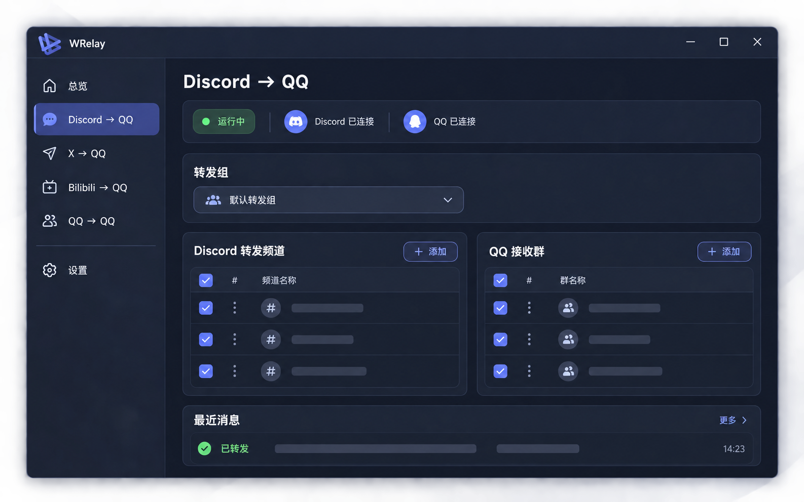

# WRelay 设计概念图

本页保存 WRelay 项目概念图和桌面窗口布局参考。桌面程序采用 WebView2 窗口、左侧导航和托盘入口；图片中的占位条仅表达视觉结构，实际数据由本地管理服务提供。

## 项目概念图

## 桌面端窗口布局

桌面端首次打开进入运行总览，集中展示机器人控制状态、各转发链路的运行状态和配置数量，并提供进入对应管理页的快捷入口。左侧保留 Discord → QQ、X → QQ、Bilibili → QQ、授权 QQ → QQ 手动转发和设置导航。

设置页单独管理桌面主题、应用版本和手动更新检查。更新检查读取 GitHub 最新稳定发行版；用户可打开发布页下载安装，不会静默下载或安装。机器人账号、翻译服务、启动方式、备份和诊断作为独立的维护区域保留。浏览器备用入口首次进入时默认打开 Discord → QQ，并与桌面端分别记忆当前页面。

转发频道和接收群列表会为操作按钮保留空间；窗口变窄时可横向滚动，过长的频道 ID / OpenID 会省略显示，悬停可查看完整值。

